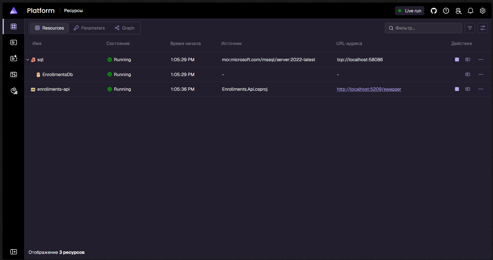
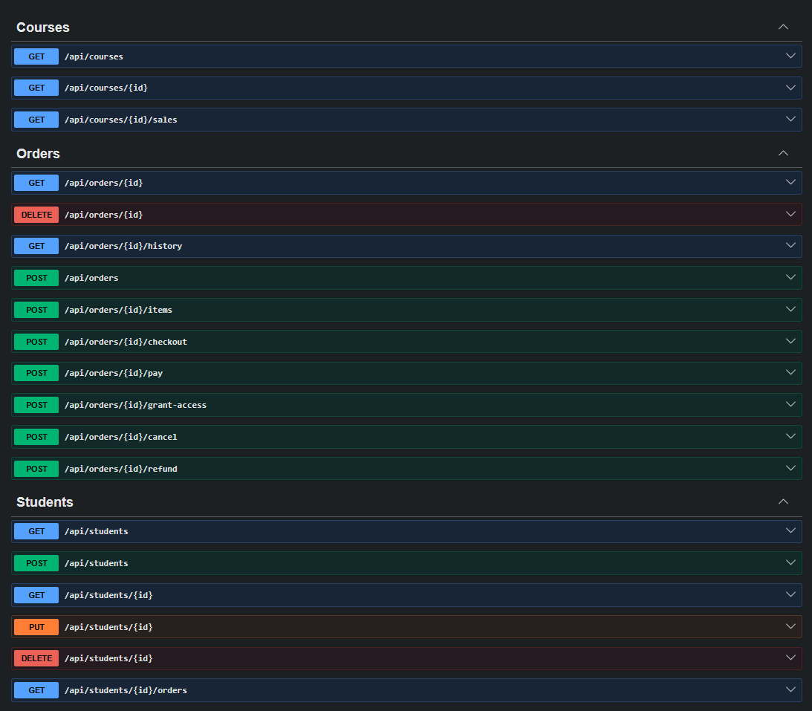
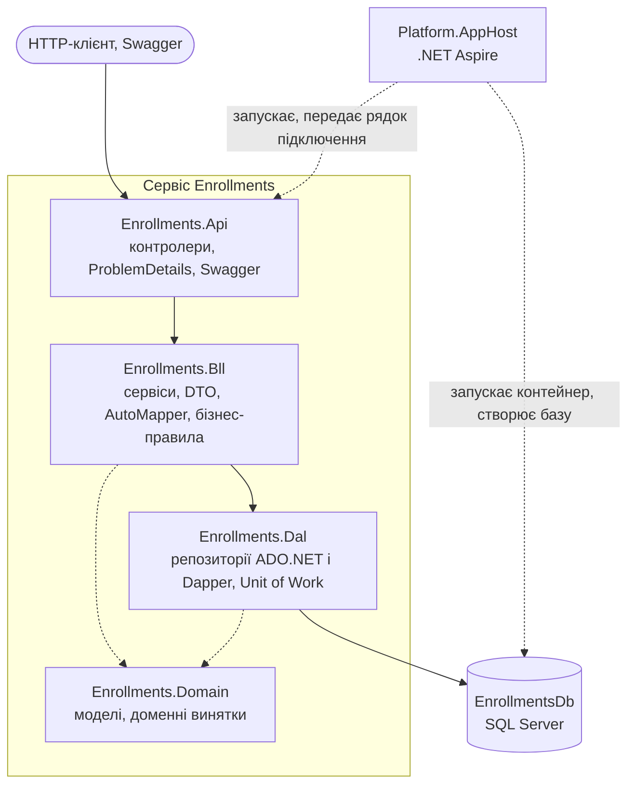
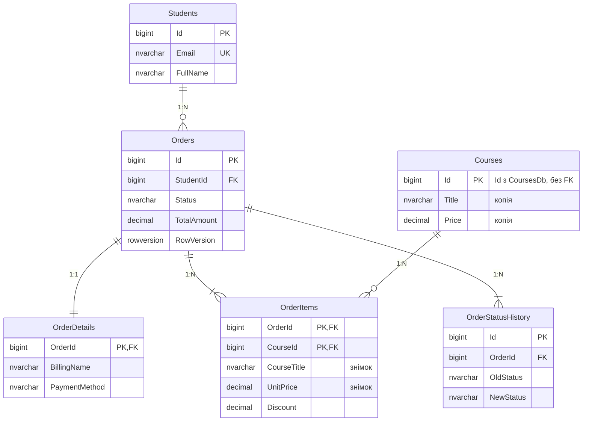
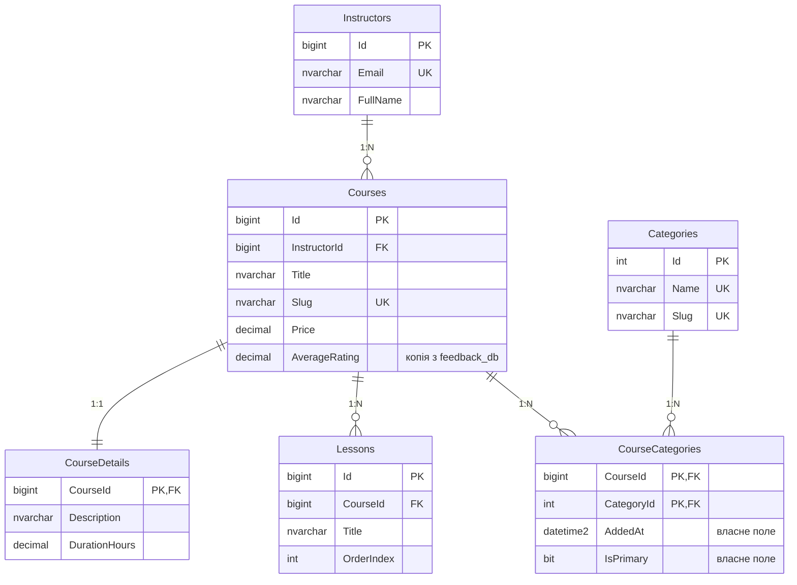

# Платформа онлайн-курсів

Навчальний мікросервісний проєкт курсу «Технології .NET у сучасній веб-інженерії».

- **Лабораторна робота №1** — проєктування баз даних для мікросервісної архітектури: три самостійні бази (дві реляційні та одна MongoDB), які разом описують предметну область.
- **Лабораторна робота №2** — сервіс `Enrollments` на базі Проєкту №1: тришарова архітектура (Web/API → BLL → DAL) на ADO.NET і Dapper з Unit of Work, запуск через .NET Aspire.

## Предметна область

Платформа онлайн-курсів. Викладачі публікують платні курси з уроками, студенти знаходять їх у каталозі, оформлюють замовлення та оплачують його, після чого отримують доступ до навчання. Студенти залишають відгуки й оцінки та ставлять питання в обговореннях курсу, а викладачі на них відповідають.

## Що потрібно для запуску

| Інструмент | Навіщо |
|---|---|
| [.NET 10 SDK](https://dotnet.microsoft.com/download) | збірка й запуск рішення `Platform.slnx` |
| Docker Desktop (запущений) | .NET Aspire піднімає в ньому контейнер SQL Server |

Окремо встановлювати SQL Server, Aspire CLI чи робочі навантаження не потрібно: оркестратор і панель Aspire приходять NuGet-пакетами під час першої збірки.

## Запуск через .NET Aspire

Одна команда з кореня репозиторію піднімає базу даних і API разом:

```powershell
dotnet run --project Platform.AppHost
```

Що відбувається:

1. Aspire запускає контейнер SQL Server (ресурс `sql`) з томом для даних.
2. Створює базу `EnrollmentsDb` скриптами Лаб. 01 — `db/p1/schema.sql`, `procedures.sql`, `seed.sql`. Скрипти ідемпотентні, тому повторні запуски нічого не дублюють.
3. Запускає `Enrollments.Api` (ресурс `enrollments-api`) і передає йому рядок підключення змінною оточення `ConnectionStrings__EnrollmentsDb`.

У консолі з'явиться посилання на **Aspire Dashboard**. У ньому обидва ресурси мають бути в статусі `Running`; там же видно адресу API, його логи та рядок підключення до бази. Swagger відкривається за адресою `<адреса API>/swagger` (типово `http://localhost:5209/swagger`).

За замовчуванням AppHost стартує профілем `http`, якому не потрібен довірений сертифікат розробника. Щоб запустити панель і API по HTTPS, один раз довірте сертифікат і вкажіть профіль явно:

```powershell
dotnet dev-certs https --trust
dotnet run --project Platform.AppHost --launch-profile https
```

Без довіреного сертифіката профіль `https` показує в Dashboard «Lost connection to the AppHost», а в консолі — помилку `UntrustedRoot`.

### Знімки екрана

Aspire Dashboard — контейнер SQL Server, база `EnrollmentsDb` і API в статусі `Running`:



Swagger — перелік ендпоінтів сервісу Enrollments:



### Запуск без Aspire

Якщо `EnrollmentsDb` уже розгорнута на власному SQL Server (див. [Розгортання баз даних вручну](#розгортання-баз-даних-вручну)), API запускається окремо. Рядок підключення береться з `Services/Enrollments/Enrollments.Api/appsettings.json` і перевизначається змінною оточення:

```powershell
$env:ConnectionStrings__EnrollmentsDb = "Server=localhost;Database=EnrollmentsDb;Trusted_Connection=True;TrustServerCertificate=True"
dotnet run --project Services/Enrollments/Enrollments.Api
```

## Схема рішення



Залежності спрямовані в один бік: `Api → Bll → Dal`, а `Domain` підключають і `Bll`, і `Dal`. Контролер ніколи не звертається до репозиторію напряму — лише через сервіс.

| Проєкт | Призначення |
|---|---|
| `Platform.AppHost` | оркестрація .NET Aspire: контейнер SQL Server, база, API |
| `Enrollments.Api` | контролери, `Program.cs` (DI, логування, Swagger), глобальний обробник помилок |
| `Enrollments.Bll` | сервіси, DTO, профілі AutoMapper, бізнес-правила |
| `Enrollments.Dal` | інтерфейси й реалізації репозиторіїв, Unit of Work, перетворення помилок SQL |
| `Enrollments.Domain` | моделі таблиць, статуси замовлення, доменні винятки |
| `Enrollments.Tests` | unit-тести BLL і API-тести (без бази даних) |

### Шар доступу до даних

| Репозиторій | Технологія | Особливості |
|---|---|---|
| `StudentRepository` | чистий ADO.NET | `SqlCommand` з типізованими параметрами, ручне читання через `SqlDataReader`; свідомо не успадковує Generic Repository; оновлення з перевіркою `RowVersion` |
| `OrderRepository` | Dapper | multi-mapping (замовлення + реквізити + позиції одним запитом), виклики процедур `usp_ChangeOrderStatus`, `usp_GetStudentOrders`, `usp_DeleteOrder`, блокування рядка `UPDLOCK` |
| `CourseRepository` | Dapper | `QueryMultipleAsync` для сторінки з лічильником, агрегація продажів |
| `OrderStatusHistoryRepository` | Dapper | журнал статусів |

Три Dapper-репозиторії успадковують `BaseDapperRepository<T>`, де спільний CRUD написано один раз. Усі значення передаються в запити лише параметрами. `UnitOfWork` відкриває одне з'єднання на HTTP-запит і роздає його всім репозиторіям разом із поточною транзакцією.

### Транзакції

| Операція | Що змінює | Як захищена |
|---|---|---|
| Оформлення замовлення (`POST /api/orders`) | `Orders`, `OrderDetails`, `OrderItems`, `OrderStatusHistory` через репозиторії `Orders` і `StatusHistory`; читає `Students` і `Courses` | транзакція Unit of Work, `ReadCommitted` |
| Додавання курсу (`POST /api/orders/{id}/items`) | `OrderItems`, `Orders.TotalAmount` | транзакція Unit of Work, `ReadCommitted` + блокування рядка замовлення (`UPDLOCK`) |
| Зміна статусу (`/checkout`, `/pay`, …) | `Orders`, `OrderStatusHistory` | процедура `usp_ChangeOrderStatus` з власною транзакцією |

Будь-яка помилка всередині транзакції відкочує всі зміни: якщо друга позиція замовлення посилається на недоступний курс, уже вставлене замовлення зникає.

**Рівень ізоляції — `ReadCommitted`.** «Брудних» читань немає, а блокування читання знімаються одразу, тож паралельні запити майже не чекають один одного. Вищі рівні (`RepeatableRead`, `Serializable`) прибирають більше аномалій, але тримають блокування до кінця транзакції — зростає час очікування й ризик взаємних блокувань. Тому там, де треба захистити послідовність «прочитав — перевірив — записав», сервіс не піднімає рівень усієї транзакції, а блокує один рядок замовлення. **Таймаут команди — 30 секунд.**

Назва й ціна курсу записуються в позицію замовлення як **знімок** з локального довідника `Courses` у момент оформлення — за політикою дублювання нижче.

### Помилки

Помилки проходять ланцюжок «процедура → DAL → BLL → HTTP-статус». DAL перетворює `SqlException` на доменні винятки, а єдиний глобальний обробник `DomainExceptionHandler` — на відповідь у форматі ProblemDetails:

| Виняток | Статус | Приклад |
|---|---|---|
| `NotFoundException` | 404 | замовлення чи студента не існує (`THROW 50001`, `50002`) |
| `BusinessConflictException` | 409 | недопустимий перехід статусу (`THROW 50003`), дубль Email, застарілий `RowVersion` |
| `ValidationException` | 400 | знижка більша за ціну курсу, один курс двічі в замовленні |
| помилка атрибутів на DTO | 400 | порожній список позицій, некоректний Email — запит відхиляється ще до виклику сервісу |
| будь-який інший | 500 | деталі лише в лозі, клієнт отримує `traceId` |

## API сервісу Enrollments

| Метод і шлях | Що робить | Успіх |
|---|---|---|
| `GET /api/students?search=&page=&pageSize=` | сторінка студентів | 200 |
| `GET /api/students/{id}` | студент | 200 |
| `POST /api/students` | створити студента | 201 + `Location` |
| `PUT /api/students/{id}` | оновити студента (з `rowVersion`) | 200 |
| `DELETE /api/students/{id}` | м'яко видалити студента | 204 |
| `GET /api/students/{id}/orders?status=` | замовлення студента | 200 |
| `GET /api/courses?search=` | курси, доступні для купівлі | 200 |
| `GET /api/courses/{id}` | курс | 200 |
| `GET /api/courses/{id}/sales` | продажі курсу | 200 |
| `GET /api/orders/{id}` | замовлення з реквізитами й позиціями | 200 |
| `GET /api/orders/{id}/history` | історія статусів | 200 |
| `POST /api/orders` | оформити замовлення | 201 + `Location` |
| `POST /api/orders/{id}/items` | додати курс до замовлення | 200 |
| `POST /api/orders/{id}/checkout` | `Submitted → AwaitingPayment` | 204 |
| `POST /api/orders/{id}/pay` | `AwaitingPayment → Paid` | 204 |
| `POST /api/orders/{id}/grant-access` | `Paid → AccessGranted` | 204 |
| `POST /api/orders/{id}/cancel` | скасувати (лише до оплати) | 204 |
| `POST /api/orders/{id}/refund` | `Paid → Refunded` | 204 |
| `DELETE /api/orders/{id}` | м'яко видалити чернетку або скасоване замовлення | 204 |

Курси в цьому сервісі лише читаються: це локальна копія довідника, власником якого є сервіс Courses.

## Приклади запитів

Ті самі запити у форматі для VS Code та Visual Studio лежать у [Enrollments.Api.http](Services/Enrollments/Enrollments.Api/Enrollments.Api.http). Нижче — `curl`; замініть адресу на ту, що показує Aspire Dashboard.

Оформити замовлення — транзакція через кілька репозиторіїв, відповідь `201 Created` із заголовком `Location`:

```bash
curl -i -X POST http://localhost:5209/api/orders \
  -H "Content-Type: application/json" \
  -d '{"studentId":3,"billingName":"Sofiia Lysenko","billingEmail":"sofiia.lysenko@example.com","paymentMethod":"Card","items":[{"courseId":2,"discount":100},{"courseId":4,"discount":0}]}'
```

Прочитати замовлення з позиціями — у позиціях видно знімок назви й ціни курсу:

```bash
curl http://localhost:5209/api/orders/1
```

Пройти життєвий цикл замовлення 3 — кожен крок повертає `204 No Content`:

```bash
curl -i -X POST http://localhost:5209/api/orders/3/checkout
curl -i -X POST http://localhost:5209/api/orders/3/pay
curl -i -X POST http://localhost:5209/api/orders/3/grant-access
```

Оплатити вже оплачене замовлення — `409 Conflict` у форматі ProblemDetails:

```bash
curl -i -X POST http://localhost:5209/api/orders/3/pay
```

```json
{
  "type": "https://tools.ietf.org/html/rfc9110#section-15.5.10",
  "title": "Business rule conflict",
  "status": 409,
  "detail": "Status transition AccessGranted -> Paid is not allowed",
  "traceId": "0HNG..."
}
```

Відкат транзакції — курс 6 недоступний, тому `409`, і замовлення не створюється:

```bash
curl -i -X POST http://localhost:5209/api/orders \
  -H "Content-Type: application/json" \
  -d '{"studentId":3,"billingName":"Sofiia Lysenko","billingEmail":"sofiia.lysenko@example.com","paymentMethod":"Card","items":[{"courseId":2,"discount":0},{"courseId":6,"discount":0}]}'
```

Неіснуюче замовлення — `404 Not Found`, а не `500`:

```bash
curl -i http://localhost:5209/api/orders/999999
```

Некоректний запит — `400 Bad Request` із переліком помилок ще до виклику сервісу:

```bash
curl -i -X POST http://localhost:5209/api/orders \
  -H "Content-Type: application/json" \
  -d '{"studentId":0,"billingName":"","billingEmail":"not-an-email","paymentMethod":"Cash","items":[]}'
```

Значення зі спецсимволом — апостроф в імені не викликає помилки SQL, бо всі значення йдуть параметрами:

```bash
curl -i -X POST http://localhost:5209/api/students \
  -H "Content-Type: application/json" \
  -d "{\"email\":\"conan.obrien@example.com\",\"fullName\":\"Conan O'Brien\"}"
```

## Тести

```powershell
dotnet test Platform.slnx
```

Тести не потребують бази даних: unit-тести BLL замінюють репозиторії та Unit of Work підставними об'єктами (перевіряють знімок назви й ціни, відкат транзакції при помилці, доменні винятки), а API-тести піднімають справжній конвеєр ASP.NET Core з підставними сервісами (перевіряють статуси 201, 204, 400, 404, 409, 500, формат ProblemDetails і опис Swagger). Окремий тест перевіряє конфігурацію AutoMapper (`AssertConfigurationIsValid`).

## Контексти та бази даних

Систему поділено на три незалежні контексти (Bounded Contexts). Кожен має власну базу; кожна сутність належить рівно одному контексту.

| Проєкт | Контекст | База даних | Технологія | Власні сутності |
|---|---|---|---|---|
| №1 | **Enrollments** — замовлення та оплата | `EnrollmentsDb` (SQL Server) | ADO.NET + Dapper | `Student`, `Order`, `OrderDetails`, `OrderItem`, `OrderStatusHistory` |
| №2 | **Courses** — каталог курсів | `CoursesDb` (SQL Server) | EF Core, Code First | `Instructor`, `Course`, `CourseDetail`, `Category`, `CourseCategory`, `Lesson` |
| №3 | **Feedback** — відгуки й обговорення | `feedback_db` (MongoDB) | документна модель | `reviews`, `discussions`, `messages`, `course_ratings` |

Чому саме така технологія для кожного контексту:

- **Enrollments → SQL + збережувані процедури.** Замовлення — транзакційний процес зі строгим життєвим циклом статусів; потрібні транзакції, блокування й перевірка цілісності на рівні бази.
- **Courses → SQL + EF Core.** Багато сутностей зі зв'язками всіх типів і довідниковими даними; зручно описувати через Fluent API та змінювати міграціями.
- **Feedback → MongoDB.** Відгуки й повідомлення мають змінну структуру (фото, відео, фрагменти коду, вкладені відповіді) і читаються цілими агрегатами.

Таблиця `Courses` у `EnrollmentsDb` — не окрема сутність контексту Enrollments, а локальна копія довідника з контексту Courses: власником курсу залишається `CoursesDb`, а Enrollments цю копію лише читає (див. [політику дублювання](#політика-дублювання-даних)).

Докладно про агрегати, життєвий цикл і обґрунтування рішень — у [docs/contexts.md](docs/contexts.md).

## Межі між базами

Три бази повністю самостійні: спільних таблиць немає, **жодного `FOREIGN KEY` між базами немає**. Посилання на сутність іншого контексту — звичайний стовпець або поле з її ідентифікатором, без обмеження в СУБД; цілісність такого посилання за потреби перевіряє прикладний код.

| Де | Поле | На що посилається | FK |
|---|---|---|---|
| `EnrollmentsDb.Courses` | `Id` | `CoursesDb.Courses.Id` | немає |
| `feedback_db.reviews` | `courseId` | `CoursesDb.Courses.Id` | немає |
| `feedback_db.reviews` | `author.studentId` | `EnrollmentsDb.Students.Id` | немає |
| `feedback_db.discussions`, `messages` | `author.userId` | `EnrollmentsDb.Students.Id` або `CoursesDb.Instructors.Id` | немає |
| `feedback_db.course_ratings` | `_id` | `CoursesDb.Courses.Id` | немає |

Усі зовнішні ключі в SQL-скриптах з'єднують таблиці однієї бази. Це перевіряє запит `SELECT * FROM sys.foreign_keys` у [db/p1/checks.sql](db/p1/checks.sql) і [db/p2/checks.sql](db/p2/checks.sql).

## Політика дублювання даних

Дублювання роз'єднує сервіси: щоб показати замовлення чи відгук, не потрібен синхронний виклик до каталогу. Для кожного дубльованого поля визначено одного власника; копію змінює лише обробник подій від власника, тож подвійного запису немає. Узгодженість — eventual consistency через події (механізм — у Лаб. 08).

| Поле | Де зберігається | Джерело (власник даних) | Політика узгодженості |
|---|---|---|---|
| `OrderItems.CourseTitle`, `OrderItems.UnitPrice` | `EnrollmentsDb` | `Courses.Title`, `Courses.Price` (`CoursesDb`) | **знімок** на момент оформлення — не оновлюється |
| `Courses.Title`, `Courses.Price`, `Courses.IsAvailable` (локальна копія довідника) | `EnrollmentsDb` | `Courses.Title`, `Price`, `IsPublished` (`CoursesDb`) | оновлюється подіями `CoursePublished`, `CourseUpdated`, `CourseUnpublished` |
| `reviews.courseTitle`, `discussions.courseTitle`, `course_ratings.courseTitle` | `feedback_db` | `Courses.Title` (`CoursesDb`) | оновлюється подією `CourseUpdated` |
| `Courses.AverageRating`, `Courses.ReviewsCount` | `CoursesDb` | `course_ratings` (`feedback_db`) | оновлюється подією `CourseRatingChanged` |
| `reviews.author.displayName`, `author.displayName` студента в `discussions`, `messages`, `reviews.comments`, а також `lastMessage.authorName` і `recentReviews.authorName` | `feedback_db` | `Students.FullName` (`EnrollmentsDb`) | оновлюється подією `StudentRenamed` |
| `reviews.isVerifiedPurchase` | `feedback_db` | `Orders.Status` (`EnrollmentsDb`) | оновлюється подіями `OrderAccessGranted`, `OrderRefunded` |
| `author.displayName` викладача в `discussions`, `messages`, `reviews.comments`, а також `lastMessage.authorName` | `feedback_db` | `Instructors.FullName` (`CoursesDb`) | оновлюється подією `InstructorRenamed` |
| `discussions.lastMessage`, `course_ratings.recentReviews` | `feedback_db` | `messages`, `reviews` (та сама база) | оновлюється в тій самій операції запису, що й оригінал |

Два різні випадки:

- **Знімок** (`OrderItems.CourseTitle`, `UnitPrice`) фіксує умови покупки й свідомо не змінюється. У тестових даних курс «C# для початківців» куплено за 1000.00, а зараз він коштує 1200.00 — позиція замовлення зберігає стару ціну. Знімок робить процедура `usp_AddOrderItem`.
- **Копія для читання** (решта рядків) має наздоганяти оригінал і оновлюється подіями від власника.

Покриття пар сервісів: Enrollments ↔ Courses — рядки 1–2, Feedback ↔ Courses — рядки 3, 4, 7, Feedback ↔ Enrollments — рядки 5–6.

## ERD

ERD-діаграми обох реляційних баз — зображеннями нижче. Вихідний текст діаграм, перелік обмежень та індексів: [docs/erd-p1.md](docs/erd-p1.md), [docs/erd-p2.md](docs/erd-p2.md). Документна модель MongoDB з прикладами документів: [docs/mongodb-model.md](docs/mongodb-model.md).

### Проєкт №1 — `EnrollmentsDb`


Та сама схема текстом (лише ключі та головні поля):



Зв'язки: **1:1** `Orders` ↔ `OrderDetails` (FK є водночас PK), **1:N** `Students` → `Orders`, **M:N** `Orders` ↔ `Courses` через проміжну таблицю `OrderItems`.

### Проєкт №2 — `CoursesDb`


Та сама схема текстом (лише ключі та головні поля):



Зв'язки: **1:1** `Courses` ↔ `CourseDetails`, **1:N** `Instructors` → `Courses` і `Courses` → `Lessons`, **M:N** `Courses` ↔ `Categories` через проміжну сутність `CourseCategories` з власними полями `AddedAt` та `IsPrimary`.

### Проєкт №3 — `feedback_db`

| Колекція | Прийом моделювання |
|---|---|
| `reviews` | гібрид: вбудовані автор і коментарі + посилання на `discussions` |
| `discussions` | гібрид: вбудований знімок останнього повідомлення + посилання на `messages` |
| `messages` | referencing: посилання на тему та батьківське повідомлення |
| `course_ratings` | embedding: розподіл оцінок і останні відгуки всередині документа |

## Структура репозиторію

```
README.md                  опис домену, запуск, розгортання БД, таблиця дублювання, ERD
Platform.slnx              одне рішення на всю платформу
Platform.AppHost/          оркестрація .NET Aspire (AppHost.cs)
Services/
  Enrollments/             Проєкт №1 — ADO.NET + Dapper
    Enrollments.Api/       контролери, Program.cs, appsettings.json, обробник помилок
    Enrollments.Bll/       сервіси, DTO, профілі AutoMapper, бізнес-правила
    Enrollments.Dal/       інтерфейси й реалізації репозиторіїв, Unit of Work
    Enrollments.Domain/    моделі, статуси, доменні винятки
    Enrollments.Tests/     unit-тести BLL і API-тести
docs/
  contexts.md              контексти, агрегати, обґрунтування рішень
  erd-p1.md, erd-p1.png    ERD, обмеження, індекси та процедури Проєкту №1
  erd-p2.md, erd-p2.png    ERD, обмеження та індекси Проєкту №2
  mongodb-model.md         колекції, приклади документів, індекси, запити
db/
  docker-compose.yml       SQL Server і MongoDB для локального запуску
  p1/                      Проєкт №1 — EnrollmentsDb
    schema.sql             таблиці, ключі, обмеження, індекси, представлення
    procedures.sql         6 збережуваних процедур
    seed.sql               тестові дані
    checks.sql             запити перевірки
  p2/                      Проєкт №2 — CoursesDb
    schema.sql             таблиці, ключі, обмеження, індекси
    seed.sql               довідникові й тестові дані
    checks.sql             запити перевірки
  p3/                      Проєкт №3 — feedback_db (MongoDB)
    collections.js         колекції з валідаторами та індекси
    seed.js                тестові документи
    queries.js             запити перевірки та aggregation pipeline
```

## Розгортання баз даних вручну

Базу `EnrollmentsDb` для сервісу Enrollments створює сам Aspire (див. [Запуск через .NET Aspire](#запуск-через-net-aspire)). Цей розділ потрібен, щоб розгорнути всі три бази без Aspire — на власному SQL Server і MongoDB або в контейнерах із `db/docker-compose.yml`.

Потрібні SQL Server 2019 або новіший і MongoDB 6 або новіша. Усі скрипти ідемпотентні: їх можна запускати повторно.

### Порядок запуску

| Крок | База | Скрипт | Що робить |
|---|---|---|---|
| 1 | `EnrollmentsDb` | `db/p1/schema.sql` | створює базу, таблиці, індекси, представлення, роль |
| 2 | `EnrollmentsDb` | `db/p1/procedures.sql` | створює 6 збережуваних процедур |
| 3 | `EnrollmentsDb` | `db/p1/seed.sql` | додає тестові дані |
| 4 | `CoursesDb` | `db/p2/schema.sql` | створює базу, таблиці, індекси, роль |
| 5 | `CoursesDb` | `db/p2/seed.sql` | додає довідникові й тестові дані |
| 6 | `feedback_db` | `db/p3/collections.js` | створює колекції з валідаторами та індекси |
| 7 | `feedback_db` | `db/p3/seed.js` | додає тестові документи |

Бази створюються самими скриптами (`CREATE DATABASE` у `schema.sql`, `getSiblingDB` у `collections.js`), окремо створювати їх не треба.

### Варіант А — Docker

Потрібен Docker Desktop. Команди виконуються з кореня репозиторію.

```powershell
docker compose -f db/docker-compose.yml up -d
```

SQL Server стартує 20–30 секунд. Далі:

```powershell
function Invoke-Sql($file) {
    docker exec lab01-sqlserver /opt/mssql-tools18/bin/sqlcmd -S localhost -U sa -P "Lab01_StrongPass2026" -C -I -b -i $file
}

# Проєкт №1
Invoke-Sql /scripts/p1/schema.sql
Invoke-Sql /scripts/p1/procedures.sql
Invoke-Sql /scripts/p1/seed.sql

# Проєкт №2
Invoke-Sql /scripts/p2/schema.sql
Invoke-Sql /scripts/p2/seed.sql

# Проєкт №3
docker exec lab01-mongo mongosh --quiet --file /scripts/p3/collections.js
docker exec lab01-mongo mongosh --quiet --file /scripts/p3/seed.js
```

Папка `db/` змонтована в контейнери як `/scripts`. Пароль `sa` призначений лише для локальної розробки; його можна змінити змінною середовища `MSSQL_SA_PASSWORD`.

### Варіант Б — власні SQL Server і MongoDB

Через `sqlcmd` (ключ `-I` вмикає `QUOTED_IDENTIFIER`, `-f 65001` читає файли як UTF-8):

```powershell
sqlcmd -S localhost -E -I -b -f 65001 -i db/p1/schema.sql
sqlcmd -S localhost -E -I -b -f 65001 -i db/p1/procedures.sql
sqlcmd -S localhost -E -I -b -f 65001 -i db/p1/seed.sql
sqlcmd -S localhost -E -I -b -f 65001 -i db/p2/schema.sql
sqlcmd -S localhost -E -I -b -f 65001 -i db/p2/seed.sql

mongosh "mongodb://localhost:27017" db/p3/collections.js
mongosh "mongodb://localhost:27017" db/p3/seed.js
```

Або в SSMS / Azure Data Studio: відкрити файли в тому самому порядку й виконати кожен цілком (F5).

### Окремий логін застосунку (найменші привілеї)

Скрипти створюють ролі `enrollments_app` і `courses_app` з правами лише у своїй базі. Логін для сервісу створюється окремо й отримує доступ тільки до однієї бази:

```sql
CREATE LOGIN enrollments_service WITH PASSWORD = '<пароль>';
USE EnrollmentsDb;
CREATE USER enrollments_service FOR LOGIN enrollments_service;
ALTER ROLE enrollments_app ADD MEMBER enrollments_service;
```

Для `CoursesDb` — так само з роллю `courses_app`.

## Перевірка

Скрипти перевірки нічого не залишають у базах.

```powershell
sqlcmd -S localhost -E -I -f 65001 -i db/p1/checks.sql
sqlcmd -S localhost -E -I -f 65001 -i db/p2/checks.sql
mongosh "mongodb://localhost:27017" db/p3/queries.js
```

| Що перевірити | Як | Очікуваний результат |
|---|---|---|
| Немає FK між базами | п. 1 у `checks.sql` обох баз (`sys.foreign_keys`) | усі FK посилаються на таблиці тієї самої бази |
| Індекси створено | п. 2 у `checks.sql` | перелік індексів із фільтрами |
| Недопустимий перехід статусу | п. 5.3 у `db/p1/checks.sql`: `Submitted → AccessGranted` | керована помилка `50003`, статус не змінився |
| Скасування після оплати | п. 5.6 у `db/p1/checks.sql` | керована помилка `50003` |
| Оптимістична конкурентність | п. 5.4 у `db/p1/checks.sql`: застарілий `RowVersion` | керована помилка `50004` |
| `CHECK` і `UNIQUE` | п. 6 у `db/p1/checks.sql`, п. 7 у `db/p2/checks.sql` | вставка відхиляється |
| Гнучка схема MongoDB | п. 2–3 у `db/p3/queries.js` | документи з різними наборами полів |
| Ідемпотентність seed | запустити `seed.sql` / `seed.js` двічі | кількість рядків не змінюється: P1 — 4 / 6 / 6 / 6 / 8 / 17, P2 — 5 / 3 / 6 / 6 / 9 / 12, P3 — 4 / 3 / 5 / 3 |

Приклад виклику процедури зі свідомо недопустимим переходом — відкрити доступ до неоплаченого замовлення:

```sql
USE EnrollmentsDb;
EXEC dbo.usp_ChangeOrderStatus @OrderId = 3, @NewStatus = N'AccessGranted';
-- Msg 50003: Status transition Submitted -> AccessGranted is not allowed
```

## Збережувані процедури Проєкту №1

| Процедура | Операція | Що робить |
|---|---|---|
| `usp_CreateOrder` | Create | створює замовлення, реквізити й перший запис журналу однією транзакцією |
| `usp_AddOrderItem` | Update | додає курс у замовлення, фіксує знімок назви й ціни, перераховує суму |
| `usp_GetOrderById` | Read | замовлення, його позиції та історія статусів |
| `usp_GetStudentOrders` | Read | замовлення студента з фільтром за статусом і пагінацією |
| `usp_ChangeOrderStatus` | Update | транзакційна зміна статусу з перевіркою допустимості переходу |
| `usp_DeleteOrder` | Delete | м'яке видалення чернетки або скасованого замовлення |

Допустимі переходи: `Submitted → AwaitingPayment → Paid → AccessGranted`; скасування (`Cancelled`) — лише до оплати; повернення (`Refunded`) — лише після оплати й до відкриття доступу.

## Що далі

Наступні роботи додають сервіси для двох інших баз: Лаб. 03 — EF Core поверх `CoursesDb`, Лаб. 04 — MongoDB поверх `feedback_db`.
