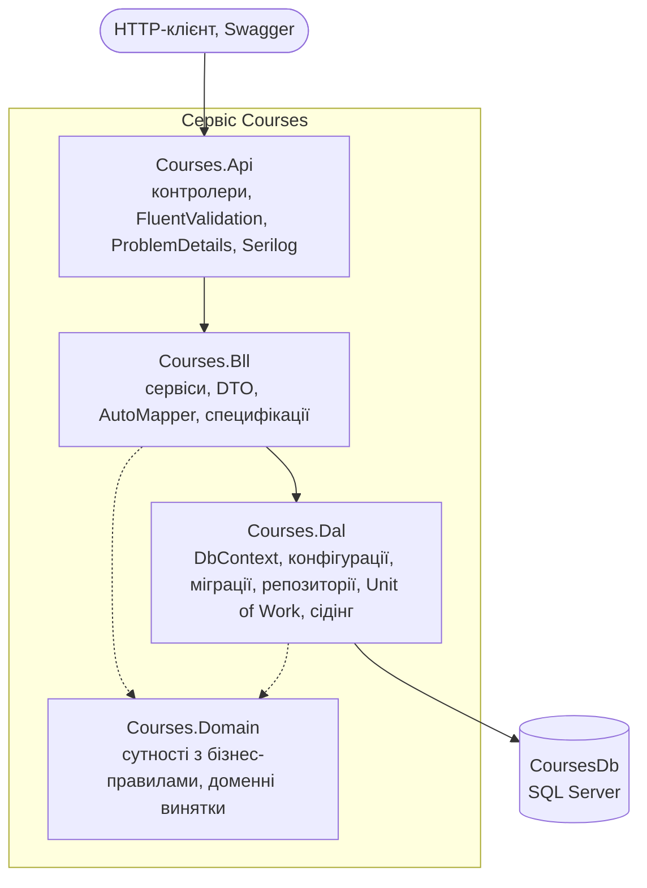
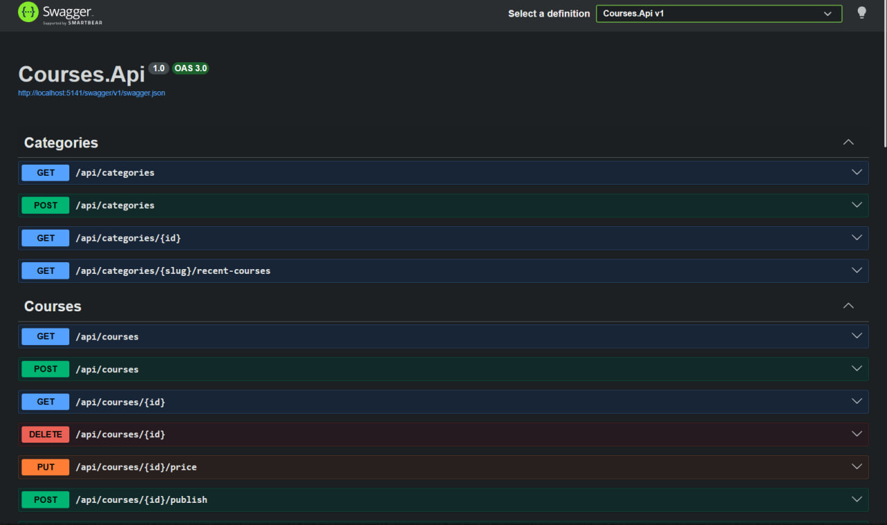
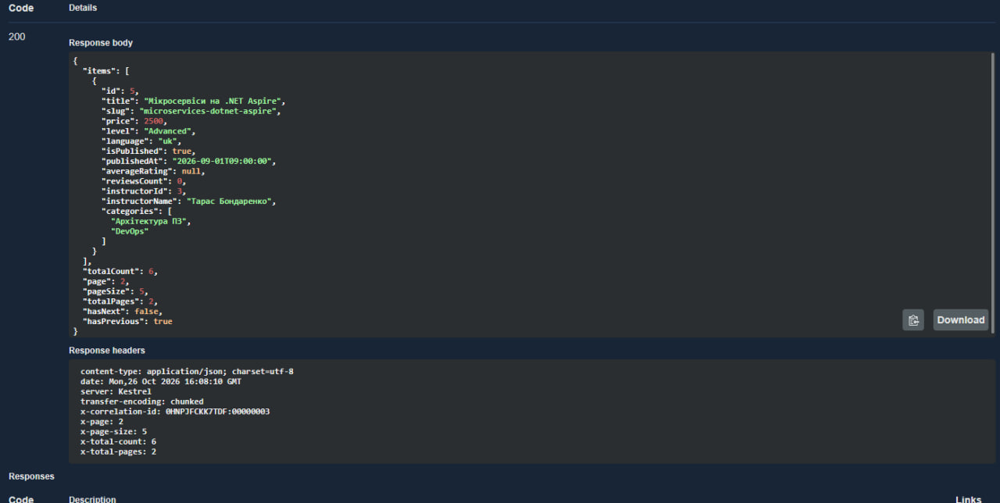
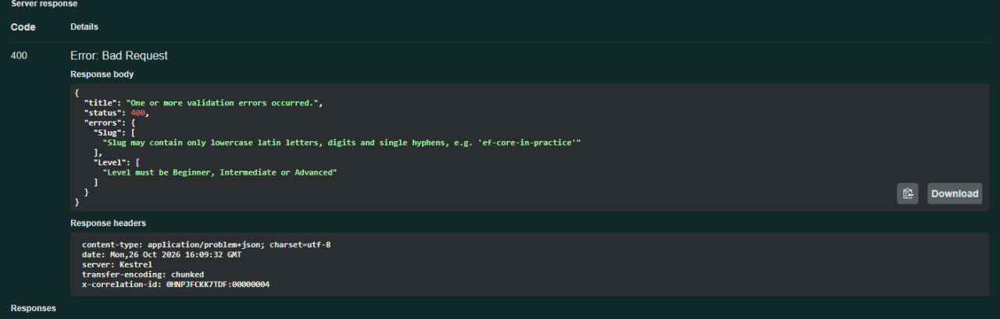
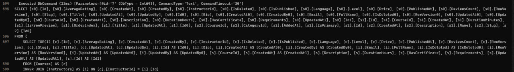
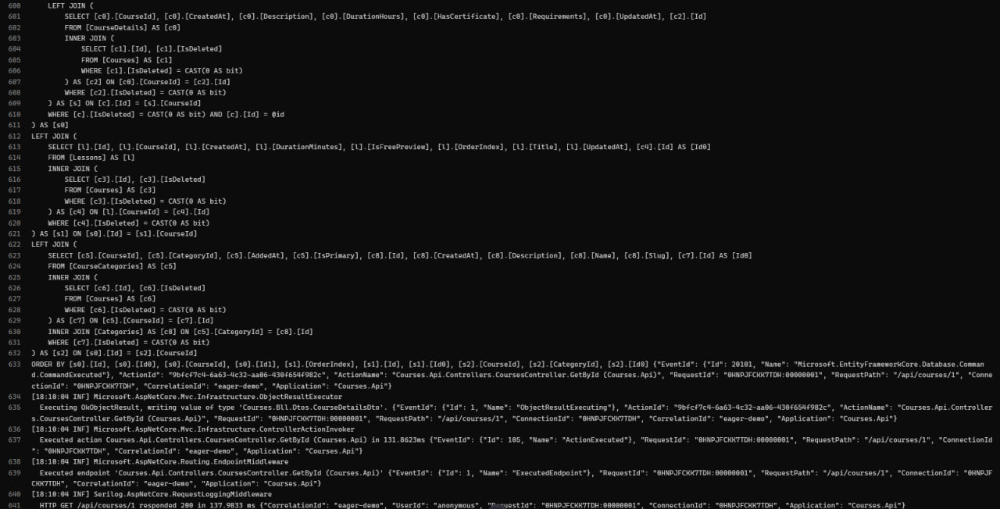
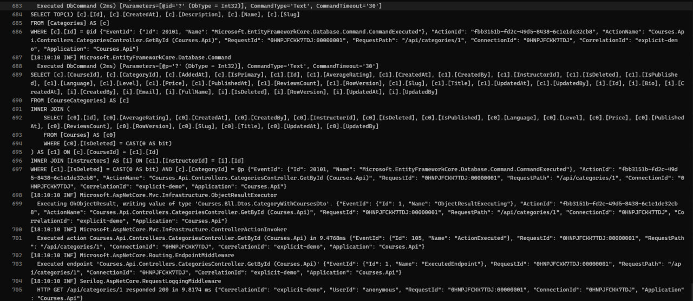
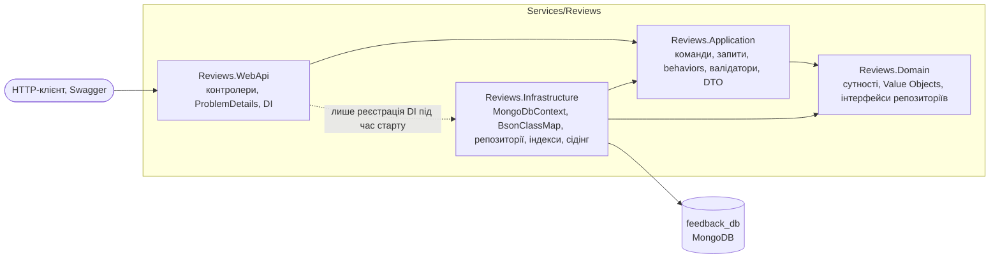
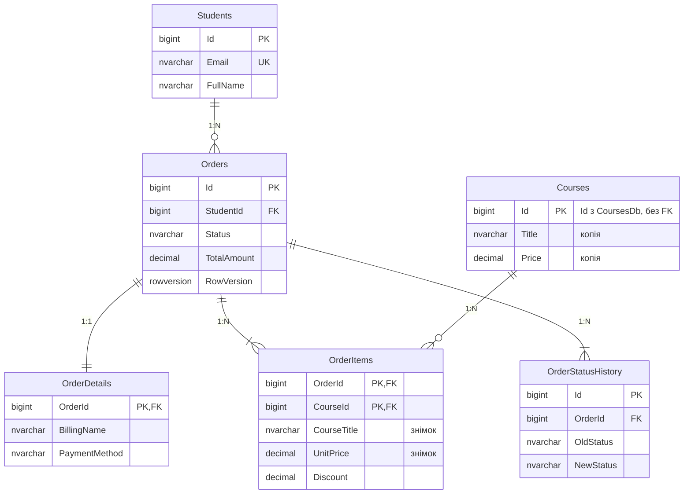
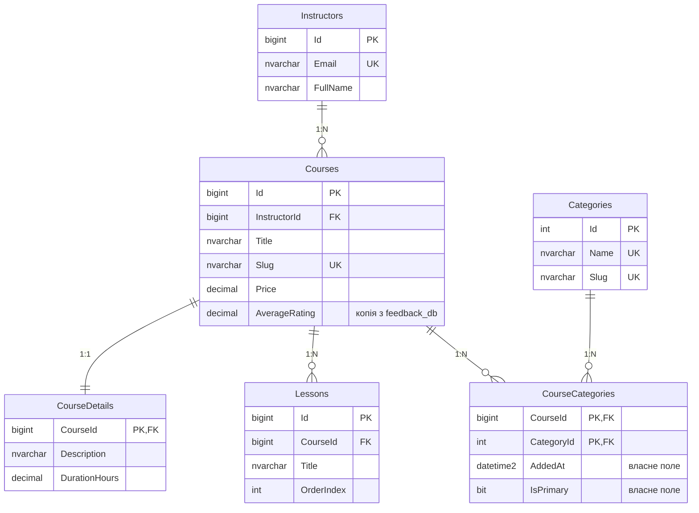

# Платформа онлайн-курсів

Навчальний мікросервісний проєкт курсу «Технології .NET у сучасній веб-інженерії».

- **Лабораторна робота №1** — проєктування баз даних для мікросервісної архітектури: три самостійні бази (дві реляційні та одна MongoDB), які разом описують предметну область.
- **Лабораторна робота №2** — сервіс `Enrollments` на базі Проєкту №1: тришарова архітектура (Web/API → BLL → DAL) на ADO.NET і Dapper з Unit of Work, запуск через .NET Aspire.
- **Лабораторна робота №3** — сервіс `Courses` на базі Проєкту №2: EF Core Code First, Fluent API, міграції й сідінг, Generic Repository і Unit of Work, специфікації, пагінація, FluentValidation, Serilog. Див. [Сервіс Courses](#сервіс-courses--ef-core-лаб-03).
- **Лабораторна робота №4** — сервіс `Reviews` на базі Проєкту №3: Clean Architecture з чотирьох шарів, CQRS і MediatR із pipeline behaviors, Value Objects, MongoDB з BsonClassMap, оптимістичною конкурентністю, індексами й сідінгом. Див. [Сервіс Reviews](#сервіс-reviews--clean-architecture-cqrs-mongodb-лаб-04).

## Предметна область

Платформа онлайн-курсів. Викладачі публікують платні курси з уроками, студенти знаходять їх у каталозі, оформлюють замовлення та оплачують його, після чого отримують доступ до навчання. Студенти залишають відгуки й оцінки та ставлять питання в обговореннях курсу, а викладачі на них відповідають.

## Що потрібно для запуску

| Інструмент | Навіщо |
|---|---|
| [.NET 10 SDK](https://dotnet.microsoft.com/download) | збірка й запуск рішення `Platform.slnx` |
| Docker Desktop (запущений) | .NET Aspire піднімає в ньому контейнери SQL Server і MongoDB |

Окремо встановлювати SQL Server, Aspire CLI чи робочі навантаження не потрібно: оркестратор і панель Aspire приходять NuGet-пакетами під час першої збірки.

## Запуск через .NET Aspire

Одна команда з кореня репозиторію піднімає базу даних і API разом:

```powershell
dotnet run --project Platform.AppHost
```

Що відбувається:

1. Aspire запускає контейнер SQL Server (ресурс `sql`) з томом для даних.
2. Створює базу `EnrollmentsDb` скриптами Лаб. 01 — `db/p1/schema.sql`, `procedures.sql`, `seed.sql`. Скрипти ідемпотентні, тому повторні запуски нічого не дублюють.
3. Запускає `Enrollments.Api` (ресурс `enrollments-api`) і передає йому рядок підключення змінною оточення `ConnectionStrings__EnrollmentsDb`.
4. Створює порожню базу `CoursesDb` і запускає `Courses.Api` (ресурс `courses-api`). Під час старту сервіс сам застосовує міграції EF Core і наповнює базу початковими даними.
5. Запускає контейнер MongoDB (ресурс `mongo`, порт `27017`, том для даних) і `Reviews.WebApi` (ресурс `reviews-api`) з рядком підключення в `MongoDb__ConnectionString`. Сервіс сам створює індекси й додає початкові документи в `feedback_db`.

У консолі з'явиться посилання на **Aspire Dashboard**. У ньому всі ресурси мають бути в статусі `Running`; там же видно адреси API, їхні логи та рядки підключення до баз.

| Сервіс | Swagger |
|---|---|
| Enrollments (Лаб. 02) | `http://localhost:5209/swagger` |
| Courses (Лаб. 03) | `http://localhost:5141/swagger` |
| Reviews (Лаб. 04) | `http://localhost:5310/swagger` |

За замовчуванням AppHost стартує профілем `http`, якому не потрібен довірений сертифікат розробника. Щоб запустити панель і API по HTTPS, один раз довірте сертифікат і вкажіть профіль явно:

```powershell
dotnet dev-certs https --trust
dotnet run --project Platform.AppHost --launch-profile https
```

Без довіреного сертифіката профіль `https` показує в Dashboard «Lost connection to the AppHost», а в консолі — помилку `UntrustedRoot`.

### Знімки екрана

Aspire Dashboard — контейнер SQL Server, база `EnrollmentsDb` і API в статусі `Running`:


Swagger — перелік ендпоінтів сервісу Enrollments:


### Запуск без Aspire

Якщо `EnrollmentsDb` уже розгорнута на власному SQL Server (див. [Розгортання баз даних вручну](#розгортання-баз-даних-вручну)), API запускається окремо. Рядок підключення береться з `Services/Enrollments/Enrollments.Api/appsettings.json` і перевизначається змінною оточення:

```powershell
$env:ConnectionStrings__EnrollmentsDb = "Server=localhost;Database=EnrollmentsDb;Trusted_Connection=True;TrustServerCertificate=True"
dotnet run --project Services/Enrollments/Enrollments.Api
```

## Схема рішення


Залежності спрямовані в один бік: `Api → Bll → Dal`, а `Domain` підключають і `Bll`, і `Dal`. Контролер ніколи не звертається до репозиторію напряму — лише через сервіс.

| Проєкт | Призначення |
|---|---|
| `Platform.AppHost` | оркестрація .NET Aspire: контейнер SQL Server, база, API |
| `Enrollments.Api` | контролери, `Program.cs` (DI, логування, Swagger), глобальний обробник помилок |
| `Enrollments.Bll` | сервіси, DTO, профілі AutoMapper, бізнес-правила |
| `Enrollments.Dal` | інтерфейси й реалізації репозиторіїв, Unit of Work, перетворення помилок SQL |
| `Enrollments.Domain` | моделі таблиць, статуси замовлення, доменні винятки |
| `Enrollments.Tests` | unit-тести BLL і API-тести (без бази даних) |

### Шар доступу до даних

| Репозиторій | Технологія | Особливості |
|---|---|---|
| `StudentRepository` | чистий ADO.NET | `SqlCommand` з типізованими параметрами, ручне читання через `SqlDataReader`; свідомо не успадковує Generic Repository; оновлення з перевіркою `RowVersion` |
| `OrderRepository` | Dapper | multi-mapping (замовлення + реквізити + позиції одним запитом), виклики процедур `usp_ChangeOrderStatus`, `usp_GetStudentOrders`, `usp_DeleteOrder`, блокування рядка `UPDLOCK` |
| `CourseRepository` | Dapper | `QueryMultipleAsync` для сторінки з лічильником, агрегація продажів |
| `OrderStatusHistoryRepository` | Dapper | журнал статусів |

Три Dapper-репозиторії успадковують `BaseDapperRepository<T>`, де спільний CRUD написано один раз. Усі значення передаються в запити лише параметрами. `UnitOfWork` відкриває одне з'єднання на HTTP-запит і роздає його всім репозиторіям разом із поточною транзакцією.

### Транзакції

| Операція | Що змінює | Як захищена |
|---|---|---|
| Оформлення замовлення (`POST /api/orders`) | `Orders`, `OrderDetails`, `OrderItems`, `OrderStatusHistory` через репозиторії `Orders` і `StatusHistory`; читає `Students` і `Courses` | транзакція Unit of Work, `ReadCommitted` |
| Додавання курсу (`POST /api/orders/{id}/items`) | `OrderItems`, `Orders.TotalAmount` | транзакція Unit of Work, `ReadCommitted` + блокування рядка замовлення (`UPDLOCK`) |
| Зміна статусу (`/checkout`, `/pay`, …) | `Orders`, `OrderStatusHistory` | процедура `usp_ChangeOrderStatus` з власною транзакцією |

Будь-яка помилка всередині транзакції відкочує всі зміни: якщо друга позиція замовлення посилається на недоступний курс, уже вставлене замовлення зникає.

**Рівень ізоляції — `ReadCommitted`.** «Брудних» читань немає, а блокування читання знімаються одразу, тож паралельні запити майже не чекають один одного. Вищі рівні (`RepeatableRead`, `Serializable`) прибирають більше аномалій, але тримають блокування до кінця транзакції — зростає час очікування й ризик взаємних блокувань. Тому там, де треба захистити послідовність «прочитав — перевірив — записав», сервіс не піднімає рівень усієї транзакції, а блокує один рядок замовлення. **Таймаут команди — 30 секунд.**

Назва й ціна курсу записуються в позицію замовлення як **знімок** з локального довідника `Courses` у момент оформлення — за політикою дублювання нижче.

### Помилки

Помилки проходять ланцюжок «процедура → DAL → BLL → HTTP-статус». DAL перетворює `SqlException` на доменні винятки, а єдиний глобальний обробник `DomainExceptionHandler` — на відповідь у форматі ProblemDetails:

| Виняток | Статус | Приклад |
|---|---|---|
| `NotFoundException` | 404 | замовлення чи студента не існує (`THROW 50001`, `50002`) |
| `BusinessConflictException` | 409 | недопустимий перехід статусу (`THROW 50003`), дубль Email, застарілий `RowVersion` |
| `ValidationException` | 400 | знижка більша за ціну курсу, один курс двічі в замовленні |
| помилка атрибутів на DTO | 400 | порожній список позицій, некоректний Email — запит відхиляється ще до виклику сервісу |
| будь-який інший | 500 | деталі лише в лозі, клієнт отримує `traceId` |

## API сервісу Enrollments

| Метод і шлях | Що робить | Успіх |
|---|---|---|
| `GET /api/students?search=&page=&pageSize=` | сторінка студентів | 200 |
| `GET /api/students/{id}` | студент | 200 |
| `POST /api/students` | створити студента | 201 + `Location` |
| `PUT /api/students/{id}` | оновити студента (з `rowVersion`) | 200 |
| `DELETE /api/students/{id}` | м'яко видалити студента | 204 |
| `GET /api/students/{id}/orders?status=` | замовлення студента | 200 |
| `GET /api/courses?search=` | курси, доступні для купівлі | 200 |
| `GET /api/courses/{id}` | курс | 200 |
| `GET /api/courses/{id}/sales` | продажі курсу | 200 |
| `GET /api/orders/{id}` | замовлення з реквізитами й позиціями | 200 |
| `GET /api/orders/{id}/history` | історія статусів | 200 |
| `POST /api/orders` | оформити замовлення | 201 + `Location` |
| `POST /api/orders/{id}/items` | додати курс до замовлення | 200 |
| `POST /api/orders/{id}/checkout` | `Submitted → AwaitingPayment` | 204 |
| `POST /api/orders/{id}/pay` | `AwaitingPayment → Paid` | 204 |
| `POST /api/orders/{id}/grant-access` | `Paid → AccessGranted` | 204 |
| `POST /api/orders/{id}/cancel` | скасувати (лише до оплати) | 204 |
| `POST /api/orders/{id}/refund` | `Paid → Refunded` | 204 |
| `DELETE /api/orders/{id}` | м'яко видалити чернетку або скасоване замовлення | 204 |

Курси в цьому сервісі лише читаються: це локальна копія довідника, власником якого є сервіс Courses.

## Приклади запитів

Ті самі запити у форматі для VS Code та Visual Studio лежать у [Enrollments.Api.http](Services/Enrollments/Enrollments.Api/Enrollments.Api.http). Нижче — `curl`; замініть адресу на ту, що показує Aspire Dashboard.

Оформити замовлення — транзакція через кілька репозиторіїв, відповідь `201 Created` із заголовком `Location`:

```bash
curl -i -X POST http://localhost:5209/api/orders \
  -H "Content-Type: application/json" \
  -d '{"studentId":3,"billingName":"Sofiia Lysenko","billingEmail":"sofiia.lysenko@example.com","paymentMethod":"Card","items":[{"courseId":2,"discount":100},{"courseId":4,"discount":0}]}'
```

Прочитати замовлення з позиціями — у позиціях видно знімок назви й ціни курсу:

```bash
curl http://localhost:5209/api/orders/1
```

Пройти життєвий цикл замовлення 3 — кожен крок повертає `204 No Content`:

```bash
curl -i -X POST http://localhost:5209/api/orders/3/checkout
curl -i -X POST http://localhost:5209/api/orders/3/pay
curl -i -X POST http://localhost:5209/api/orders/3/grant-access
```

Оплатити вже оплачене замовлення — `409 Conflict` у форматі ProblemDetails:

```bash
curl -i -X POST http://localhost:5209/api/orders/3/pay
```

```json
{
  "type": "https://tools.ietf.org/html/rfc9110#section-15.5.10",
  "title": "Business rule conflict",
  "status": 409,
  "detail": "Status transition AccessGranted -> Paid is not allowed",
  "traceId": "0HNG..."
}
```

Відкат транзакції — курс 6 недоступний, тому `409`, і замовлення не створюється:

```bash
curl -i -X POST http://localhost:5209/api/orders \
  -H "Content-Type: application/json" \
  -d '{"studentId":3,"billingName":"Sofiia Lysenko","billingEmail":"sofiia.lysenko@example.com","paymentMethod":"Card","items":[{"courseId":2,"discount":0},{"courseId":6,"discount":0}]}'
```

Неіснуюче замовлення — `404 Not Found`, а не `500`:

```bash
curl -i http://localhost:5209/api/orders/999999
```

Некоректний запит — `400 Bad Request` із переліком помилок ще до виклику сервісу:

```bash
curl -i -X POST http://localhost:5209/api/orders \
  -H "Content-Type: application/json" \
  -d '{"studentId":0,"billingName":"","billingEmail":"not-an-email","paymentMethod":"Cash","items":[]}'
```

Значення зі спецсимволом — апостроф в імені не викликає помилки SQL, бо всі значення йдуть параметрами:

```bash
curl -i -X POST http://localhost:5209/api/students \
  -H "Content-Type: application/json" \
  -d "{\"email\":\"conan.obrien@example.com\",\"fullName\":\"Conan O'Brien\"}"
```

## Тести

```powershell
dotnet test Platform.slnx
```

Тести всіх сервісів не потребують ні бази, ні Docker. Для сервісу Courses окремо перевіряються правила сутностей, специфікації (на колекції в пам'яті), валідатори, відповідність моделі EF останній міграції та переклад кожного запиту репозиторіїв у SQL.

Для сервісу Reviews перевіряються:
- **правило залежностей шарів** — посилання в `*.csproj` і реальні залежності збірок, відсутність `IMongoCollection` у контролерах та обробниках;
- **бізнес-правила** сутностей і Value Objects;
- **валідатори**, зокрема асинхронні;
- **порядок behaviors** і те, що невалідна команда не доходить до обробника;
- **BSON-мапінг** — структура документа Лаб. 01, читання документа без поля `version`, сід-файли;
- **готові команди MongoDB** — `$match`, `$sort`, `$skip`, `$limit` та індекси;
- **API** зі справжнім pipeline MediatR — 201 з `Location`, 400, 404, 409 за `If-Match` і `DuplicateKey`, 503.

Тести не потребують бази даних: unit-тести BLL замінюють репозиторії та Unit of Work підставними об'єктами (перевіряють знімок назви й ціни, відкат транзакції при помилці, доменні винятки), а API-тести піднімають справжній конвеєр ASP.NET Core з підставними сервісами (перевіряють статуси 201, 204, 400, 404, 409, 500, формат ProblemDetails і опис Swagger). Окремий тест перевіряє конфігурацію AutoMapper (`AssertConfigurationIsValid`).

## Сервіс Courses — EF Core (Лаб. 03)

Сервіс каталогу курсів поверх бази Проєкту №2. Будова та сама, що в `Enrollments`, але доступ до даних побудовано на EF Core: модель у коді, Fluent API, міграції та LINQ to Entities.



| Проєкт | Що в ньому |
|---|---|
| `Courses.Domain` | 6 сутностей із приватними setter-ами: `Course`, `CourseDetail`, `Lesson`, `Category`, `CourseCategory`, `Instructor`; 4 доменні винятки |
| `Courses.Dal` | `CoursesDbContext`, `Configurations/` (по класу на сутність), `Migrations/`, Generic Repository, 4 специфічні репозиторії, `UnitOfWork`, `Seeding/DbInitializer` |
| `Courses.Bll` | 3 сервіси, DTO, профілі AutoMapper, `Specifications/`, `Validation/` (FluentValidation) |
| `Courses.Api` | 3 контролери, `DomainExceptionHandler`, `CorrelationIdMiddleware`, `Program.cs`, `Dockerfile` |
| `Courses.Tests` | 68 тестів без бази даних |

### Модель і Fluent API

Сутності не мають відкритих setter-ів: стан змінюють лише методи, які перевіряють правила самої сутності — так побудовано `CatalogItem` в eShop.

| Метод `Course` | Правило |
|---|---|
| конструктор, `ChangePrice` | ціна від 0 до 1 000 000; Slug лише з малих латинських літер, цифр і дефісів |
| `Publish` | потрібні опис і хоча б один урок; повторна публікація заборонена |
| `AddLesson` | номер уроку — наступний після наявних |
| `AssignCategory` | без дублів; основна категорія лише одна, перша додана стає основною сама |
| `Delete` | м'яке видалення; опублікований курс спершу знімають з публікації |

Правила, яким потрібні інші дані з бази (унікальність Slug та Email, існування викладача й категорій), перевіряють сервіси BLL.

Кожна сутність має окремий клас `IEntityTypeConfiguration<T>` у `Courses.Dal/Configurations`; усі вони підключаються одним рядком `ApplyConfigurationsFromAssembly` в `OnModelCreating`. Назви таблиць, обмежень та індексів збігаються зі схемою з Лаб. 01 (`db/p2/schema.sql`):

- `decimal(18,2)` для цін, довжини рядків, `datetime2(3)` для дат;
- 9 CHECK-обмежень (`CK_Courses_Price`, `CK_Courses_Level`, …);
- унікальні індекси `UQ_Courses_Slug`, `UQ_Instructors_Email`, `UQ_Categories_Name`, `UQ_Categories_Slug`, `UQ_Lessons_CourseId_OrderIndex`;
- фільтровані й покриваючі індекси `IX_Courses_Level_Price`, `IX_Courses_InstructorId`, `UX_CourseCategories_Primary`;
- `ROWVERSION` для оптимістичної конкурентності;
- глобальний фільтр `IsDeleted = 0` для м'якого видалення.

| Зв'язок | Як налаштовано |
|---|---|
| 1:1 `Course` ↔ `CourseDetail` | `HasOne(...).WithOne(...).HasForeignKey<CourseDetail>(d => d.CourseId)` — ключ є водночас FK |
| 1:N `Instructor` → `Course`, `Course` → `Lesson` | `HasMany(...).WithOne(...)`; уроки видаляються каскадом, викладач — `Restrict` |
| M:N `Course` ↔ `Category` | явна проміжна сутність `CourseCategory` зі складеним ключем і власними полями `AddedAt`, `IsPrimary` |

### Міграції

Інструмент `dotnet-ef` зафіксовано в маніфесті `dotnet-tools.json`, тож встановлюється однією командою. DbContext лежить у `Courses.Dal`, рядок підключення — у `Courses.Api`, тому вказуються обидва проєкти:

```powershell
dotnet tool restore

# нова міграція
dotnet dotnet-ef migrations add <Name> --project Services/Courses/Courses.Dal --startup-project Services/Courses/Courses.Api --output-dir Migrations

# застосувати до бази з appsettings.json (без Aspire)
dotnet dotnet-ef database update --project Services/Courses/Courses.Dal --startup-project Services/Courses/Courses.Api

# SQL-скрипт для перегляду або ручного виконання
dotnet dotnet-ef migrations script --idempotent --project Services/Courses/Courses.Dal --startup-project Services/Courses/Courses.Api --output Services/Courses/Courses.Dal/Migrations/InitialCreate.sql
```

Початкова міграція — `Courses.Dal/Migrations/*_InitialCreate.cs` разом зі знімком моделі `CoursesDbContextModelSnapshot.cs`; згенерований скрипт — `Courses.Dal/Migrations/InitialCreate.sql`. Під Aspire міграції застосовує сам сервіс під час старту (`MigrateAsync`). Тест `Model_has_no_changes_missing_from_the_migrations` падає, якщо модель змінили, а міграцію не додали.

### Сідінг

| Режим | Що | Де |
|---|---|---|
| модельний (статичний) | довідник 5 категорій із фіксованими Id | `HasData` у `CategoryConfiguration` — потрапляє в міграцію |
| програмний | 3 викладачі, 6 курсів з описами, уроками й категоріями | `DbInitializer.SeedAsync` у `Program.cs` після `MigrateAsync` |

Програмний сідінг перевіряє кожен запис перед вставкою (викладача — за Email, курс — за Slug), тож повторний запуск нічого не дублює: у лозі другого старту `0 instructor(s) and 0 course(s) inserted`. Спершу довідники (міграція), потім залежні записи — FK не порушуються. Курси вставляються по одному, тому на чистій базі мають Id 1–6, як у копії довідника `EnrollmentsDb` і в `feedback_db`.

| Параметр конфігурації | За замовчуванням | Що робить |
|---|---|---|
| `Database:MigrateOnStartup` | `true` | застосувати міграції під час старту |
| `Database:SeedOnStartup` | `true`, крім Production | виконати програмний сідінг |

### Репозиторії, Unit of Work, специфікації

| Репозиторій | Спосіб завантаження | Метод |
|---|---|---|
| `GenericRepository<T>` | `DbSet<T>` | `GetByIdAsync`, `GetAllAsync`, `AddAsync`, `ListAsync(spec)`, `CountAsync(spec)` — асинхронні; `Update`, `Delete` лише змінюють стан у контексті |
| `CourseRepository` | **Eager Loading** — `Include` / `ThenInclude`, один запит | `GetWithDetailsAsync` |
| `CategoryRepository` | **Explicit Loading** — `Entry(...).Collection(...).LoadAsync()`, два запити | `GetWithCoursesAsync` |
| `CourseCategoryRepository` | **LINQ to Entities** через проміжну сутність і її поле `AddedAt` | `GetRecentlyAddedAsync`, `CountCoursesPerCategoryAsync` |

Репозиторії не зберігають змін самі. `UnitOfWork.SaveChangesAsync` викликається один раз наприкінці бізнес-операції — EF Core записує всі зміни в одній транзакції — і перетворює конфлікт `RowVersion` та порушення унікальності на `ConflictException`.

Складні вибірки винесено в специфікації (`Ardalis.Specification`) у `Courses.Bll/Specifications`: `CoursesFilterSpec` описує фільтри, `Include`, сортування й сторінку каталогу, `InstructorCoursesSpec` — курси викладача. Репозиторій застосовує будь-яку з них тим самим `WithSpecification(spec)`, без змін у своєму коді; лічильник бере з тієї самої специфікації лише критерії `Where`.

### Пагінація, фільтрація, сортування

`GET /api/courses` приймає:

| Параметр | Значення |
|---|---|
| `page` | номер сторінки з 1 |
| `pageSize` | 1–100, за замовчуванням 20 |
| `search` | частина назви |
| `level` | `Beginner`, `Intermediate`, `Advanced` |
| `categoryId`, `instructorId` | фільтр за категорією або викладачем |
| `minPrice`, `maxPrice` | діапазон ціни |
| `isPublished` | `true` / `false` |
| `sortBy` | `title`, `price`, `publishedAt`, `rating`, `createdAt` — інші поля відхиляються з 400 |
| `sortDir` | `asc` / `desc` |

Метадані сторінки повертаються **і в тілі, і в заголовках**: тіло — `items`, `totalCount`, `page`, `pageSize`, `totalPages`, `hasNext`, `hasPrevious`; заголовки — `X-Total-Count`, `X-Total-Pages`, `X-Page`, `X-Page-Size`. Фільтри, сортування й `Skip`/`Take` застосовуються до запиту до `ToListAsync`, тому база повертає лише потрібну сторінку (`OFFSET … FETCH`), а `totalCount` рахує окремий `COUNT(*)` з тими самими фільтрами.

### Валідація та помилки

- **DataAnnotations** на DTO — прості правила: обов'язковість, довжини, діапазони. Порушення відхиляє `[ApiController]` ще до виклику контролера.
- **FluentValidation** (`Courses.Bll/Validation`) — те, чого атрибутами не виразити: формат Slug, назва рівня, дозволені поля сортування, узгодженість діапазону цін і категорій. Валідатори реєструються `AddValidatorsFromAssemblyContaining` і викликаються в контролері явно; застаріле `AddFluentValidation` не використовується.
- Обидва рівні повертають 400 у форматі `ValidationProblemDetails` з помилками по полях.

`DomainExceptionHandler` — один глобальний обробник: `EntityNotFoundException` → 404, `ValidationException` → 400, `ConflictException` і `DomainException` → 409, решта → 500. Текст несподіваної помилки показується лише в Development; у Production клієнт отримує загальне повідомлення та `traceId`. Кожен виняток логується рівно один раз — в обробнику.

### Логування (Serilog)

Конфігурація — розділ `Serilog` в `Courses.Api/appsettings.json`; рівні перевизначаються в `appsettings.Development.json` або змінними оточення (`Serilog__MinimumLevel__Default=Warning`).

| Що | Як |
|---|---|
| sinks | консоль і файл `logs/courses-api-<дата>.json` (JSON, по файлу на день, 7 днів) |
| рівні | `Information`; `Microsoft.AspNetCore` і `Microsoft.EntityFrameworkCore` — `Warning`; `Microsoft.EntityFrameworkCore.Database.Command` — `Information`, тож у лозі видно SQL кожного запиту |
| властивості | `CorrelationId` (із заголовка `X-Correlation-ID` або згенерований, повертається у відповіді), `RequestPath`, `UserId`, `SourceContext`, `Application` |
| HTTP | `UseSerilogRequestLogging` — один підсумковий запис на запит |

### Що видно в лозі SQL

Фрагменти з реального запуску; запити позначено власним `X-Correlation-ID`, щоб знайти їх у лозі:

```text
eager-demo     GET /api/courses/1     -> 1 SQL-запит
  SELECT [s0].[Id], … FROM (SELECT TOP(1) … FROM [Courses] … WHERE [c].[Id] = @id) AS [s0]
  LEFT JOIN [CourseDetails] … LEFT JOIN [Lessons] … LEFT JOIN [CourseCategories] … INNER JOIN [Categories] …

explicit-demo  GET /api/categories/1  -> 2 SQL-запити
  [1] SELECT TOP(1) [c].[Id], [c].[CreatedAt], [c].[Description], [c].[Name], [c].[Slug] FROM [Categories] AS [c] WHERE [c].[Id] = @id
  [2] SELECT [c].[CourseId], [c].[CategoryId], [c].[AddedAt], [c].[IsPrimary], [c1].[Id], … FROM [CourseCategories] AS [c] INNER JOIN …

paging-demo    GET /api/courses?page=2&pageSize=5
  [1] SELECT COUNT(*) FROM [Courses] AS [c] WHERE [c].[IsDeleted] = CAST(0 AS bit)
  [2] … WHERE [c].[IsDeleted] = CAST(0 AS bit) ORDER BY [c].[Title], [c].[Id] OFFSET @p ROWS FETCH NEXT @p ROWS ONLY
```

### API сервісу Courses

| Метод і шлях | Що робить | Успіх |
|---|---|---|
| `GET /api/courses` | сторінка каталогу з фільтрами й сортуванням | 200 |
| `GET /api/courses/{id}` | картка курсу (Eager Loading) | 200 |
| `POST /api/courses` | створити курс | 201 + `Location` |
| `PUT /api/courses/{id}/price` | змінити ціну | 204 |
| `POST /api/courses/{id}/publish`, `/unpublish` | опублікувати / зняти з публікації | 204 |
| `POST /api/courses/{id}/lessons` | додати урок | 201 + `Location` |
| `POST /api/courses/{id}/categories` | додати курс у категорію | 204 |
| `DELETE /api/courses/{id}` | м'яко видалити | 204 |
| `GET /api/categories` | категорії з кількістю курсів | 200 |
| `GET /api/categories/{id}` | категорія з курсами (Explicit Loading) | 200 |
| `GET /api/categories/{slug}/recent-courses?since=` | нещодавно додані курси (LINQ через проміжну сутність) | 200 |
| `POST /api/categories` | створити категорію | 201 + `Location` |
| `GET /api/instructors`, `/{id}` | викладачі | 200 |
| `GET /api/instructors/{id}/courses?publishedOnly=` | курси викладача (друга специфікація) | 200 |
| `POST /api/instructors` | створити викладача | 201 + `Location` |

Помилки: 400 — невалідні дані, 404 — немає ресурсу, 409 — дубль Slug/Email/категорії або порушене правило сутності.

### Приклади запитів

```bash
# сторінка 2 по 5 курсів: totalCount — кількість усіх курсів, а не на сторінці
curl -i "http://localhost:5141/api/courses?page=2&pageSize=5"

# фільтр і сортування
curl "http://localhost:5141/api/courses?level=Intermediate&sortBy=price&sortDir=desc"

# створити курс -> 201 + Location; повтор із тим самим slug -> 409
curl -i -X POST http://localhost:5141/api/courses -H "Content-Type: application/json" \
  -d '{"instructorId":2,"title":"EF Core: продуктивність запитів","slug":"ef-core-performance","price":1700,"level":"Advanced","description":"Профілювання запитів, індекси, split queries","durationHours":12.5,"categoryIds":[3,1],"primaryCategoryId":3}'

# порожня назва -> 400 з помилками по полях
curl -i -X POST http://localhost:5141/api/courses -H "Content-Type: application/json" \
  -d '{"instructorId":2,"title":"","slug":"x","price":10,"level":"Beginner","description":"short","durationHours":1,"categoryIds":[]}'

# неіснуючий курс -> 404 у форматі ProblemDetails
curl -i http://localhost:5141/api/courses/999999

# Eager і Explicit Loading із власним CorrelationId, щоб знайти їхні SQL у лозі
curl -H "X-Correlation-ID: eager-demo" http://localhost:5141/api/courses/1
curl -H "X-Correlation-ID: explicit-demo" http://localhost:5141/api/categories/1
```

### Знімки екрана

Swagger — ендпоінти сервісу Courses:



Пагінація — `GET /api/courses?page=2&pageSize=5`: на другій сторінці один курс із шести, у тілі `totalCount`, `totalPages`, `hasNext`, `hasPrevious`, ті самі числа — у заголовках `X-Total-Count`, `X-Total-Pages`, `X-Page`, `X-Page-Size`:



Валідація — `POST /api/courses` зі `"slug": "EF Core!"` і `"level": "Expert"`: FluentValidation повертає 400 у форматі `ValidationProblemDetails`:



Eager Loading — `GET /api/courses/1` (`X-Correlation-ID: eager-demo`): курс, викладач, опис, уроки й категорії приходять одним SQL-запитом з `JOIN`:





Explicit Loading — `GET /api/categories/1` (`X-Correlation-ID: explicit-demo`): спершу окремим запитом завантажується категорія, потім другим — її курси з викладачами:



### Docker-образ

```powershell
docker build -f Services/Courses/Courses.Api/Dockerfile -t courses-api .
docker run -p 8080:8080 -e ConnectionStrings__CoursesDb="Server=host.docker.internal,<port>;Database=CoursesDb;User Id=sa;Password=<пароль>;TrustServerCertificate=True" courses-api
```

Контекст збірки — корінь репозиторію. Образ багатоетапний: SDK лише для збірки, у фінальному — runtime ASP.NET Core і застосунок, запущений не від root.

## Сервіс Reviews — Clean Architecture, CQRS, MongoDB (Лаб. 04)

Сервіс контексту **Feedback** над базою `feedback_db` (Проєкт №3 з Лаб. 01): відгуки студентів про курси з коментарями та теми обговорень. На відміну від тришарових сервісів Лаб. 02–03, доменний шар тут не залежить ні від API, ні від бази.



Правило залежностей: зовнішні шари знають про внутрішні, але не навпаки. Infrastructure лише реалізує інтерфейси, оголошені всередині (`IReviewRepository` у Domain, `IReviewQueries` в Application).

| Проєкт | Що містить | Залежить від |
|---|---|---|
| `Reviews.Domain` | `Common/` (`BaseEntity`, `ValueObject`), `Entities/` (`Review`, `Comment`, `Discussion`), `ValueObjects/` (`Author`, `Participant`, `Rating`, `MessagePreview`), `Enums/`, `Exceptions/`, `Interfaces/` (`IReviewRepository`, `IDiscussionRepository`) | лише пакет `MongoDB.Bson` (тип `ObjectId`), без драйвера |
| `Reviews.Application` | `Common/Behaviors/`, `Common/Interfaces/` (`ICommand`, `IQuery`, `IReviewQueries`), `Common/Models/PagedResult`, `Reviews/Commands/*`, `Reviews/Queries/*`, `Discussions/...`, профілі AutoMapper, `DependencyInjection.cs` | Domain |
| `Reviews.Infrastructure` | `Persistence/` (`MongoDbContext`, `MongoMappings`, серіалізатори, репозиторії, `ReviewQueries`), `Seeding/` (`IDataSeeder`, сідери, `IndexCreationService`, JSON із даними), `DependencyInjection.cs` | Application, Domain |
| `Reviews.WebApi` | `Controllers/`, `Contracts/` (тіла HTTP-запитів), `Mapping/`, `ErrorHandling/GlobalExceptionHandler`, `Middleware/`, `Program.cs`, `appsettings.{Environment}.json` | Application, Infrastructure (лише для DI) |
| `Reviews.Tests` | тести домену, валідаторів, behaviors, обробників, BSON-мапінгу, запитів, архітектури та API | WebApi |

Кожен шар реєструє себе сам — `Program.cs` лише викликає три методи:

```csharp
builder.Services
    .AddApplication(builder.Configuration)       // MediatR, behaviors, валідатори
    .AddInfrastructure(builder.Configuration)    // MongoDB: мапінг, репозиторії, індекси, сідінг, health check
    .AddWebApi(builder.Configuration);           // контролери, AutoMapper, ProblemDetails, Swagger
```

### Домен

| Тип | Що забезпечує |
|---|---|
| `BaseEntity` | `Id` (`ObjectId`), `CreatedAt`, `UpdatedAt`, `Version` (новий документ — версія 1); сетери захищені |
| `ValueObject` | порівняння за значеннями компонентів (`GetEqualityComponents`), оператори `==` / `!=` |
| `Review` | вбудовані масиви `comments`, `photos`, `pros`, `cons` у приватних полях назовні — лише `IReadOnlyList`; методи `Edit`, `AddComment` (не більше 50), `Delete` (м'яке); видалений відгук змінити не можна |
| `Discussion` | переходи станів: вирішити можна лише відкрите питання, оголошення публікує лише викладач, закріпити можна лише оголошення |
| `Author`, `Participant`, `Rating`, `MessagePreview` | незмінні, без сетерів, валідація в конструкторі: `new Rating(10)` кидає `DomainException` ще до будь-якого звернення до бази |

### CQRS із MediatR

Кожна операція API — окрема команда або запит з власним обробником. Команди змінюють дані через `IReviewRepository`. Запити читають через `IReviewQueries`, реалізація якого повертає з MongoDB одразу DTO. Жоден контролер чи обробник не звертається до `IMongoCollection` — це перевіряє архітектурний тест.

| Тип | Команди | Запити |
|---|---|---|
| Відгуки | `CreateReview`, `UpdateReview`, `DeleteReview`, `AddComment` | `GetReviewById`, `GetReviewsList`, `GetCourseRating` |
| Теми | `CreateDiscussion`, `ChangeDiscussionStatus` | `GetDiscussionById`, `GetDiscussionsList` |

Кожна папка (`Reviews/Commands/CreateReview/` тощо) містить команду, обробник і валідатор.

Кожен запит проходить через ланцюжок behaviors; порядок задає `AddOpenBehavior` у `AddApplication`:

```text
контролер -> ISender.Send -> LoggingBehavior -> ValidationBehavior -> PerformanceBehavior -> обробник -> репозиторій -> MongoDB
```

| Behavior | Що робить |
|---|---|
| `LoggingBehavior` | структурований запис «Handling {RequestName} {@Request}», потім «Handled ... in N ms» або «failed ... with {ExceptionType}» |
| `ValidationBehavior` | запускає всі валідатори FluentValidation, збирає помилки разом і кидає `ValidationException` — обробник не викликається |
| `PerformanceBehavior` | міряє час самого обробника разом із запитами до MongoDB; попередження, якщо довше за `Application:SlowRequestThresholdMs` (500 мс) |

Валідатори перевіряють і MongoDB-специфічне:
- **Формат Id.** Рядок має бути коректним `ObjectId` (`ObjectId.TryParse`).
- **Один відгук від студента на курс.** Асинхронне правило `CreateReviewCommandValidator` робить запит до MongoDB.
- **`sourceReviewId` нової теми** має вказувати на наявний відгук того самого курсу.

Як виглядає в лозі команда з `Rating = 10`:

```text
[19:04:17 INF] Reviews.Application.Common.Behaviors.LoggingBehavior
  Handling CreateReviewCommand {"CourseId": 4, "CourseTitle": "DevOps для .NET-розробника", "StudentId": 257268, ..., "Rating": 10, ...}
[19:04:17 WRN] Reviews.Application.Common.Behaviors.LoggingBehavior
  CreateReviewCommand failed after 14 ms with ValidationException: Validation failed:
 -- Rating: 'Rating' must be between 1 and 5. You entered 10. Severity: Error
[19:04:17 INF] Serilog.AspNetCore.RequestLoggingMiddleware
  HTTP POST /api/reviews responded 400 in 52.2197 ms {"CorrelationId": "rating-10-demo", ...}
```

Записів обробника («Review ... created») і `PerformanceBehavior` немає: до обробника запит не дійшов. Єдина команда до MongoDB тут — пошук дубліката в асинхронному правилі валідатора. Для порівняння, успішна команда додає записи `Handler CreateReviewCommand executed in N ms` і `Review {ReviewId} created`.

### MongoDB

**Мапінг.** `MongoMappings.Register()` налаштовує `BsonClassMap` один раз під час старту, ще до першого звернення до бази. У доменних класах немає жодного BSON-атрибута. Документ має ту саму структуру, що в Лаб. 01:

- **Імена полів** у camelCase (`CamelCaseElementNameConvention`). Поля, яких немає в класі, ігноруються (`IgnoreExtraElementsConvention`).
- **Значення null не записуються** (`IgnoreIfNullConvention`), порожні масиви теж. Тож відгук «лише оцінка» не має полів `text` чи `comments`, як і вимагає гнучка схема.
- **Приватні поля** `_comments`, `_photos`, `_pros`, `_cons` і `_tags` записуються як `comments`, `photos`, `pros`, `cons` і `tags`.
- **Value Objects** створюються через конструктор (`MapCreator`), тож валідація спрацьовує й під час читання. `Rating` зберігається звичайним числом (`RatingSerializer`).
- **Перерахування** зберігаються рядками в нижньому регістрі: `"student"`, `"open"`.
- **Сутності** створюються з бази приватним конструктором без параметрів. Стандартну конвенцію `ImmutableTypeClassMapConvention` для них вимкнено, бо інакше драйвер обирав би публічний конструктор з бізнес-валідацією.

Документ відгуку, записаний сервісом:

```json
{
  "_id": ObjectId("670000000000000000000101"),
  "createdAt": ISODate("2026-09-20T19:00:00Z"),
  "updatedAt": ISODate("2026-09-22T17:05:00Z"),
  "version": 3,
  "courseId": Long(1),
  "courseTitle": "C# для початківців",
  "author": { "studentId": Long(1), "displayName": "Олена Коваль" },
  "rating": 5,
  "text": "Найзрозуміліший курс для старту: ...",
  "isVerifiedPurchase": true,
  "discussionId": ObjectId("670000000000000000000201"),
  "isDeleted": false,
  "comments": [
    { "author": { "userId": Long(1), "role": "instructor", "displayName": "Андрій Мельник" },
      "text": "Дякую за відгук! ...", "createdAt": ISODate("2026-09-21T08:30:00Z") }
  ],
  "photos": ["reviews/101/certificate.jpg", "reviews/101/final-project.png"]
}
```

Документи, які записує сервіс, проходять валідатори `$jsonSchema` з `db/p3/collections.js`. Це перевірено наживо: скрипт Лаб. 01 застосовано до бази сервісу, і всі сценарії запису пройшли.

**Оптимістична конкурентність.** Оновлення — це один атомарний `ReplaceOne` з фільтром `{ _id, version: <очікувана> }`, і версія при цьому зростає на 1. Якщо документ тим часом змінив хтось інший, фільтр нічого не знаходить, і обробник отримує `ConflictException` (409). Клієнт отримує версію в заголовку `ETag` і повертає її в `If-Match`. Застарілу версію з `If-Match` відхиляє вже обробник, ще до зміни сутності. Теми, створені скриптом Лаб. 01, не мають поля `version`; для них фільтр приймає і `version: 1`, і відсутнє поле.

**Читання.** Список — це один aggregation pipeline: спершу `$match` (фільтр, `$text`-пошук), потім `$facet` з двома гілками. Перша дає сторінку: `$sort`, `$skip`, `$limit` і `$project`, де `$toString` перетворює `_id` на рядок, а `$size` рахує коментарі. Друга, `$count`, дає загальну кількість. Сервер повертає вже готову форму DTO, а сервіс лише десеріалізує її в record. Рейтинг курсу рахує `$group` із `$avg` і кількістю відгуків на кожну оцінку.

**Індекси** створює `IndexCreationService` під час старту. Назви й параметри ті самі, що в `db/p3/collections.js`, тож скрипт і сервіс не конфліктують, а повторне створення наявного індексу MongoDB пропускає.

| Колекція | Індекс | Навіщо |
|---|---|---|
| `reviews` | `ix_reviews_course_createdAt` `{ courseId: 1, createdAt: -1 }` | відгуки курсу, найновіші перші |
| `reviews` | `ux_reviews_course_student` `{ courseId: 1, "author.studentId": 1 }`, унікальний | один відгук студента на курс |
| `reviews` | `ix_reviews_student` `{ "author.studentId": 1 }` | відгуки студента |
| `reviews` | `ix_reviews_discussion` `{ discussionId: 1 }`, частковий | відгук, з якого виросла тема |
| `reviews` | `ix_reviews_text` `{ text: "text" }` | повнотекстовий пошук `?search=` |
| `discussions` | `ix_discussions_course_status_updatedAt` | теми курсу за станом, спершу активні |
| `discussions` | `ix_discussions_tags` (multikey) | теми за тегом |
| `discussions` | `ix_discussions_title_text` | пошук по заголовках |

**Сідінг.** `ReviewSeeder` і `DiscussionSeeder` (`IDataSeeder`) читають документи з `Seeding/Data/*.json` у форматі Extended JSON. Це ті самі документи, що в `db/p3/seed.js`, зі сталими `_id`. Сідер одним запитом з'ясовує, які `_id` уже є в базі, і вставляє решту одним `InsertManyAsync`. Повторний старт пише в лог `Seeding reviews: 0 inserted, 4 already present`.

**Конфігурація.** Секція `MongoDb` (`MongoDbOptions` через `IOptions`, перевіряється під час старту). Пул з'єднань і таймаути задаються параметрами рядка підключення.

| Файл | Рядок підключення | Сідінг |
|---|---|---|
| `appsettings.json` | `localhost:27017`, `maxPoolSize=50`, `serverSelectionTimeoutMS=5000` | так |
| `appsettings.Development.json` | `localhost:27017`, коротші таймаути (3 с) | так |
| `appsettings.Staging.json` | `mongo-staging`, база `feedback_db_staging` | так |
| `appsettings.Production.json` | replica set із трьох вузлів, `w=majority`, `retryWrites=true` | ні |

Під Aspire рядок підключення приходить змінною оточення `MongoDb__ConnectionString`. Стан бази показує `GET /health` — health check `AspNetCore.HealthChecks.MongoDb`.

### Помилки

`GlobalExceptionHandler` (`IExceptionHandler` + `AddProblemDetails`) перетворює винятки на ProblemDetails. До кожної відповіді додаються `traceId` і `correlationId`.

| Виняток | Статус |
|---|---|
| `ValidationException` (FluentValidation) | 400, `ValidationProblemDetails` з усіма помилками, згрупованими за полем |
| `DomainException` | 400 |
| `NotFoundException` | 404 |
| `ConflictException` (застаріла версія) | 409 |
| `MongoWriteException` з `DuplicateKey` (унікальний індекс) | 409 |
| інший `MongoWriteException` (наприклад, документ не пройшов `$jsonSchema`) | 400 |
| `MongoConnectionException`, тайм-аут вибору сервера | 503 із заголовком `Retry-After` |
| усе інше | 500 |

Тексти винятків драйвера містять адреси серверів і дані документів, тому назовні вони йдуть лише в Development.

Повторний відгук того самого студента відхиляється двома способами. Зазвичай це робить асинхронний валідатор: 400 з помилкою `StudentId`. Якщо два однакові запити прийшли одночасно, обидва можуть пройти валідатор, і тоді другий відсікає унікальний індекс: 409 `Duplicate key`. Наживо з 12 одночасних однакових запитів вийшло 1 × 201, 6 × 400 і 5 × 409.

### API сервісу Reviews

| Метод і шлях | Що робить | Успіх |
|---|---|---|
| `GET /api/reviews?courseId=&studentId=&minRating=&search=&sortBy=&sortDir=&page=&pageSize=` | список відгуків | 200 + `X-Total-Count`, `X-Total-Pages` |
| `GET /api/reviews/{id}` | відгук із коментарями | 200 + `ETag` |
| `POST /api/reviews` | новий відгук | 201 + `Location: /api/reviews/{ObjectId}` |
| `PUT /api/reviews/{id}` + `If-Match` | зміна оцінки, тексту, переваг, недоліків | 200 + новий `ETag` |
| `DELETE /api/reviews/{id}` + `If-Match` | м'яке видалення | 204 |
| `POST /api/reviews/{id}/comments` | коментар у вбудований масив | 201 |
| `GET /api/courses/{courseId}/rating` | середня оцінка й розподіл (aggregation) | 200 |
| `GET /api/discussions?courseId=&status=&tag=&search=&page=&pageSize=` | теми | 200 |
| `GET /api/discussions/{id}` | тема | 200 + `ETag` |
| `POST /api/discussions` | нова тема (питання чи оголошення) | 201 |
| `PUT /api/discussions/{id}/status` + `If-Match` | `open` / `resolved` / `closed` | 200 |
| `GET /health` | стан підключення до MongoDB | 200 / 503 |

Swagger: `http://localhost:5310/swagger`.

### Приклади запитів

```bash
# відгуки курсу 1, друга сторінка по одному
curl -i "http://localhost:5310/api/reviews?courseId=1&page=2&pageSize=1"

# повнотекстовий пошук і рейтинг курсу
curl "http://localhost:5310/api/reviews?search=асинхронність"
curl "http://localhost:5310/api/courses/1/rating"

# Rating = 10 -> 400 ще до обробника; X-Correlation-ID допомагає знайти записи в лозі
curl -i -X POST http://localhost:5310/api/reviews -H "Content-Type: application/json" \
  -H "X-Correlation-ID: rating-10-demo" \
  -d '{"courseId":4,"courseTitle":"DevOps для .NET-розробника","studentId":10,"authorName":"Тарас","rating":10}'

# новий відгук -> 201, Location з рядковим ObjectId, ETag: "1"
curl -i -X POST http://localhost:5310/api/reviews -H "Content-Type: application/json" \
  -d '{"courseId":4,"courseTitle":"DevOps для .NET-розробника","studentId":10,"authorName":"Тарас","rating":5,"text":"Docker без зайвої теорії"}'

# той самий студент і курс ще раз -> 400 (асинхронне правило з запитом до MongoDB)

# конфлікт версій: перша зміна з If-Match "1" -> 200 і ETag "2"; друга з тим самим "1" -> 409
curl -i -X PUT http://localhost:5310/api/reviews/<id> -H "Content-Type: application/json" -H 'If-Match: "1"' -d '{"rating":4}'
curl -i -X PUT http://localhost:5310/api/reviews/<id> -H "Content-Type: application/json" -H 'If-Match: "1"' -d '{"rating":3}'

# некоректний ObjectId -> 400, неіснуючий -> 404
curl -i http://localhost:5310/api/reviews/123
curl -i http://localhost:5310/api/reviews/6700000000000000000009ff
```

### MongoDB Compass і перевірка індексів

Під Aspire MongoDB слухає сталий порт `27017`. Користувач — `admin`. Пароль видно в Aspire Dashboard: вкладка **Parameters**, параметр `mongo-password`.

- **Compass.** Рядок підключення — `mongodb://admin:<пароль>@localhost:27017/?authSource=admin`. Далі база `feedback_db` → колекція `reviews`; індекси показує вкладка **Indexes**.
- **mongosh.** Він вбудований у Compass (панель `_MONGOSH` унизу) і є в контейнері:

```powershell
docker ps --filter "name=mongo"     # ім'я контейнера, наприклад mongo-abcd1234
docker exec -it <контейнер> mongosh -u admin -p <пароль> --authenticationDatabase admin feedback_db --eval "db.reviews.getIndexes()"
```

### Запуск без Aspire

```powershell
docker run -d --name feedback-mongo -p 27017:27017 mongo:8.0
dotnet run --project Services/Reviews/Reviews.WebApi
```

Рядок підключення з `appsettings.Development.json` (`mongodb://localhost:27017`) підійде без змін. Індекси й дані сервіс створить сам. Можна також спершу виконати `db/p3/collections.js` і `seed.js` з Лаб. 01 — сервіс і скрипти не конфліктують.

## Контексти та бази даних

Систему поділено на три незалежні контексти (Bounded Contexts). Кожен має власну базу; кожна сутність належить рівно одному контексту.

| Проєкт | Контекст | База даних | Технологія | Власні сутності |
|---|---|---|---|---|
| №1 | **Enrollments** — замовлення та оплата | `EnrollmentsDb` (SQL Server) | ADO.NET + Dapper | `Student`, `Order`, `OrderDetails`, `OrderItem`, `OrderStatusHistory` |
| №2 | **Courses** — каталог курсів | `CoursesDb` (SQL Server) | EF Core, Code First | `Instructor`, `Course`, `CourseDetail`, `Category`, `CourseCategory`, `Lesson` |
| №3 | **Feedback** — відгуки й обговорення | `feedback_db` (MongoDB) | документна модель | `reviews`, `discussions`, `messages`, `course_ratings` |

Чому саме така технологія для кожного контексту:

- **Enrollments → SQL + збережувані процедури.** Замовлення — транзакційний процес зі строгим життєвим циклом статусів; потрібні транзакції, блокування й перевірка цілісності на рівні бази.
- **Courses → SQL + EF Core.** Багато сутностей зі зв'язками всіх типів і довідниковими даними; зручно описувати через Fluent API та змінювати міграціями.
- **Feedback → MongoDB.** Відгуки й повідомлення мають змінну структуру (фото, відео, фрагменти коду, вкладені відповіді) і читаються цілими агрегатами.

Таблиця `Courses` у `EnrollmentsDb` — не окрема сутність контексту Enrollments, а локальна копія довідника з контексту Courses: власником курсу залишається `CoursesDb`, а Enrollments цю копію лише читає (див. [політику дублювання](#політика-дублювання-даних)).

Докладно про агрегати, життєвий цикл і обґрунтування рішень — у [docs/contexts.md](docs/contexts.md).

## Межі між базами

Три бази повністю самостійні: спільних таблиць немає, **жодного `FOREIGN KEY` між базами немає**. Посилання на сутність іншого контексту — звичайний стовпець або поле з її ідентифікатором, без обмеження в СУБД; цілісність такого посилання за потреби перевіряє прикладний код.

| Де | Поле | На що посилається | FK |
|---|---|---|---|
| `EnrollmentsDb.Courses` | `Id` | `CoursesDb.Courses.Id` | немає |
| `feedback_db.reviews` | `courseId` | `CoursesDb.Courses.Id` | немає |
| `feedback_db.reviews` | `author.studentId` | `EnrollmentsDb.Students.Id` | немає |
| `feedback_db.discussions`, `messages` | `author.userId` | `EnrollmentsDb.Students.Id` або `CoursesDb.Instructors.Id` | немає |
| `feedback_db.course_ratings` | `_id` | `CoursesDb.Courses.Id` | немає |

Усі зовнішні ключі в SQL-скриптах з'єднують таблиці однієї бази. Це перевіряє запит `SELECT * FROM sys.foreign_keys` у [db/p1/checks.sql](db/p1/checks.sql) і [db/p2/checks.sql](db/p2/checks.sql).

## Політика дублювання даних

Дублювання роз'єднує сервіси: щоб показати замовлення чи відгук, не потрібен синхронний виклик до каталогу. Для кожного дубльованого поля визначено одного власника; копію змінює лише обробник подій від власника, тож подвійного запису немає. Узгодженість — eventual consistency через події (механізм — у Лаб. 08).

| Поле | Де зберігається | Джерело (власник даних) | Політика узгодженості |
|---|---|---|---|
| `OrderItems.CourseTitle`, `OrderItems.UnitPrice` | `EnrollmentsDb` | `Courses.Title`, `Courses.Price` (`CoursesDb`) | **знімок** на момент оформлення — не оновлюється |
| `Courses.Title`, `Courses.Price`, `Courses.IsAvailable` (локальна копія довідника) | `EnrollmentsDb` | `Courses.Title`, `Price`, `IsPublished` (`CoursesDb`) | оновлюється подіями `CoursePublished`, `CourseUpdated`, `CourseUnpublished` |
| `reviews.courseTitle`, `discussions.courseTitle`, `course_ratings.courseTitle` | `feedback_db` | `Courses.Title` (`CoursesDb`) | оновлюється подією `CourseUpdated` |
| `Courses.AverageRating`, `Courses.ReviewsCount` | `CoursesDb` | `course_ratings` (`feedback_db`) | оновлюється подією `CourseRatingChanged` |
| `reviews.author.displayName`, `author.displayName` студента в `discussions`, `messages`, `reviews.comments`, а також `lastMessage.authorName` і `recentReviews.authorName` | `feedback_db` | `Students.FullName` (`EnrollmentsDb`) | оновлюється подією `StudentRenamed` |
| `reviews.isVerifiedPurchase` | `feedback_db` | `Orders.Status` (`EnrollmentsDb`) | оновлюється подіями `OrderAccessGranted`, `OrderRefunded` |
| `author.displayName` викладача в `discussions`, `messages`, `reviews.comments`, а також `lastMessage.authorName` | `feedback_db` | `Instructors.FullName` (`CoursesDb`) | оновлюється подією `InstructorRenamed` |
| `discussions.lastMessage`, `course_ratings.recentReviews` | `feedback_db` | `messages`, `reviews` (та сама база) | оновлюється в тій самій операції запису, що й оригінал |

Два різні випадки:

- **Знімок** (`OrderItems.CourseTitle`, `UnitPrice`) фіксує умови покупки й свідомо не змінюється. У тестових даних курс «C# для початківців» куплено за 1000.00, а зараз він коштує 1200.00 — позиція замовлення зберігає стару ціну. Знімок робить процедура `usp_AddOrderItem`.
- **Копія для читання** (решта рядків) має наздоганяти оригінал і оновлюється подіями від власника.

Покриття пар сервісів: Enrollments ↔ Courses — рядки 1–2, Feedback ↔ Courses — рядки 3, 4, 7, Feedback ↔ Enrollments — рядки 5–6.

## ERD

ERD-діаграми обох реляційних баз — зображеннями нижче. Вихідний текст діаграм, перелік обмежень та індексів: [docs/erd-p1.md](docs/erd-p1.md), [docs/erd-p2.md](docs/erd-p2.md). Документна модель MongoDB з прикладами документів: [docs/mongodb-model.md](docs/mongodb-model.md).

### Проєкт №1 — `EnrollmentsDb`


Та сама схема текстом (лише ключі та головні поля):



Зв'язки: **1:1** `Orders` ↔ `OrderDetails` (FK є водночас PK), **1:N** `Students` → `Orders`, **M:N** `Orders` ↔ `Courses` через проміжну таблицю `OrderItems`.

### Проєкт №2 — `CoursesDb`


Та сама схема текстом (лише ключі та головні поля):



Зв'язки: **1:1** `Courses` ↔ `CourseDetails`, **1:N** `Instructors` → `Courses` і `Courses` → `Lessons`, **M:N** `Courses` ↔ `Categories` через проміжну сутність `CourseCategories` з власними полями `AddedAt` та `IsPrimary`.

### Проєкт №3 — `feedback_db`

| Колекція | Прийом моделювання |
|---|---|
| `reviews` | гібрид: вбудовані автор і коментарі + посилання на `discussions` |
| `discussions` | гібрид: вбудований знімок останнього повідомлення + посилання на `messages` |
| `messages` | referencing: посилання на тему та батьківське повідомлення |
| `course_ratings` | embedding: розподіл оцінок і останні відгуки всередині документа |

## Структура репозиторію

```
README.md                  опис домену, запуск, розгортання БД, таблиця дублювання, ERD
Platform.slnx              одне рішення на всю платформу
Platform.AppHost/          оркестрація .NET Aspire (AppHost.cs)
Services/
  Enrollments/             Проєкт №1 — ADO.NET + Dapper
    Enrollments.Api/       контролери, Program.cs, appsettings.json, обробник помилок
    Enrollments.Bll/       сервіси, DTO, профілі AutoMapper, бізнес-правила
    Enrollments.Dal/       інтерфейси й реалізації репозиторіїв, Unit of Work
    Enrollments.Domain/    моделі, статуси, доменні винятки
    Enrollments.Tests/     unit-тести BLL і API-тести
  Courses/                 Проєкт №2 — EF Core
    Courses.Api/           контролери, Program.cs, appsettings.json, обробник помилок, Dockerfile
    Courses.Bll/           сервіси, DTO, профілі AutoMapper, специфікації, валідатори
    Courses.Dal/           DbContext, Configurations/, Migrations/, репозиторії, Unit of Work, Seeding/
    Courses.Domain/        сутності з бізнес-правилами, доменні винятки
    Courses.Tests/         тести домену, специфікацій, валідаторів, сервісів, моделі EF та API
  Reviews/                 Проєкт №3 — Clean Architecture + CQRS + MongoDB
    Reviews.Domain/        сутності, value objects, перерахування, доменні винятки, інтерфейси репозиторіїв
    Reviews.Application/   Commands/, Queries/, Common/Behaviors/, валідатори, DTO, профілі AutoMapper
    Reviews.Infrastructure/ Persistence/ (Mongo-контекст, BSON-мапінг, репозиторії, читання), Seeding/
    Reviews.WebApi/        контролери, Program.cs, обробка помилок, appsettings.{Environment}.json
    Reviews.Tests/         тести домену, behaviors, BSON-мапінгу, запитів, архітектури та API
dotnet-tools.json          локальний інструмент dotnet-ef
docs/
  contexts.md              контексти, агрегати, обґрунтування рішень
  erd-p1.md, erd-p1.png    ERD, обмеження, індекси та процедури Проєкту №1
  erd-p2.md, erd-p2.png    ERD, обмеження та індекси Проєкту №2
  mongodb-model.md         колекції, приклади документів, індекси, запити
db/
  docker-compose.yml       SQL Server і MongoDB для локального запуску
  p1/                      Проєкт №1 — EnrollmentsDb
    schema.sql             таблиці, ключі, обмеження, індекси, представлення
    procedures.sql         6 збережуваних процедур
    seed.sql               тестові дані
    checks.sql             запити перевірки
  p2/                      Проєкт №2 — CoursesDb
    schema.sql             таблиці, ключі, обмеження, індекси
    seed.sql               довідникові й тестові дані
    checks.sql             запити перевірки
  p3/                      Проєкт №3 — feedback_db (MongoDB)
    collections.js         колекції з валідаторами та індекси
    seed.js                тестові документи
    queries.js             запити перевірки та aggregation pipeline
```

## Розгортання баз даних вручну

Базу `EnrollmentsDb` для сервісу Enrollments створює сам Aspire (див. [Запуск через .NET Aspire](#запуск-через-net-aspire)). Цей розділ потрібен, щоб розгорнути всі три бази без Aspire — на власному SQL Server і MongoDB або в контейнерах із `db/docker-compose.yml`.

Потрібні SQL Server 2019 або новіший і MongoDB 6 або новіша. Усі скрипти ідемпотентні: їх можна запускати повторно.

### Порядок запуску

| Крок | База | Скрипт | Що робить |
|---|---|---|---|
| 1 | `EnrollmentsDb` | `db/p1/schema.sql` | створює базу, таблиці, індекси, представлення, роль |
| 2 | `EnrollmentsDb` | `db/p1/procedures.sql` | створює 6 збережуваних процедур |
| 3 | `EnrollmentsDb` | `db/p1/seed.sql` | додає тестові дані |
| 4 | `CoursesDb` | `db/p2/schema.sql` | створює базу, таблиці, індекси, роль |
| 5 | `CoursesDb` | `db/p2/seed.sql` | додає довідникові й тестові дані |
| 6 | `feedback_db` | `db/p3/collections.js` | створює колекції з валідаторами та індекси |
| 7 | `feedback_db` | `db/p3/seed.js` | додає тестові документи |

Бази створюються самими скриптами (`CREATE DATABASE` у `schema.sql`, `getSiblingDB` у `collections.js`), окремо створювати їх не треба.

### Варіант А — Docker

Потрібен Docker Desktop. Команди виконуються з кореня репозиторію.

```powershell
docker compose -f db/docker-compose.yml up -d
```

SQL Server стартує 20–30 секунд. Далі:

```powershell
function Invoke-Sql($file) {
    docker exec lab01-sqlserver /opt/mssql-tools18/bin/sqlcmd -S localhost -U sa -P "Lab01_StrongPass2026" -C -I -b -i $file
}

# Проєкт №1
Invoke-Sql /scripts/p1/schema.sql
Invoke-Sql /scripts/p1/procedures.sql
Invoke-Sql /scripts/p1/seed.sql

# Проєкт №2
Invoke-Sql /scripts/p2/schema.sql
Invoke-Sql /scripts/p2/seed.sql

# Проєкт №3
docker exec lab01-mongo mongosh --quiet --file /scripts/p3/collections.js
docker exec lab01-mongo mongosh --quiet --file /scripts/p3/seed.js
```

Папка `db/` змонтована в контейнери як `/scripts`. Пароль `sa` призначений лише для локальної розробки; його можна змінити змінною середовища `MSSQL_SA_PASSWORD`.

### Варіант Б — власні SQL Server і MongoDB

Через `sqlcmd` (ключ `-I` вмикає `QUOTED_IDENTIFIER`, `-f 65001` читає файли як UTF-8):

```powershell
sqlcmd -S localhost -E -I -b -f 65001 -i db/p1/schema.sql
sqlcmd -S localhost -E -I -b -f 65001 -i db/p1/procedures.sql
sqlcmd -S localhost -E -I -b -f 65001 -i db/p1/seed.sql
sqlcmd -S localhost -E -I -b -f 65001 -i db/p2/schema.sql
sqlcmd -S localhost -E -I -b -f 65001 -i db/p2/seed.sql

mongosh "mongodb://localhost:27017" db/p3/collections.js
mongosh "mongodb://localhost:27017" db/p3/seed.js
```

Або в SSMS / Azure Data Studio: відкрити файли в тому самому порядку й виконати кожен цілком (F5).

### Окремий логін застосунку (найменші привілеї)

Скрипти створюють ролі `enrollments_app` і `courses_app` з правами лише у своїй базі. Логін для сервісу створюється окремо й отримує доступ тільки до однієї бази:

```sql
CREATE LOGIN enrollments_service WITH PASSWORD = '<пароль>';
USE EnrollmentsDb;
CREATE USER enrollments_service FOR LOGIN enrollments_service;
ALTER ROLE enrollments_app ADD MEMBER enrollments_service;
```

Для `CoursesDb` — так само з роллю `courses_app`.

## Перевірка

Скрипти перевірки нічого не залишають у базах.

```powershell
sqlcmd -S localhost -E -I -f 65001 -i db/p1/checks.sql
sqlcmd -S localhost -E -I -f 65001 -i db/p2/checks.sql
mongosh "mongodb://localhost:27017" db/p3/queries.js
```

| Що перевірити | Як | Очікуваний результат |
|---|---|---|
| Немає FK між базами | п. 1 у `checks.sql` обох баз (`sys.foreign_keys`) | усі FK посилаються на таблиці тієї самої бази |
| Індекси створено | п. 2 у `checks.sql` | перелік індексів із фільтрами |
| Недопустимий перехід статусу | п. 5.3 у `db/p1/checks.sql`: `Submitted → AccessGranted` | керована помилка `50003`, статус не змінився |
| Скасування після оплати | п. 5.6 у `db/p1/checks.sql` | керована помилка `50003` |
| Оптимістична конкурентність | п. 5.4 у `db/p1/checks.sql`: застарілий `RowVersion` | керована помилка `50004` |
| `CHECK` і `UNIQUE` | п. 6 у `db/p1/checks.sql`, п. 7 у `db/p2/checks.sql` | вставка відхиляється |
| Гнучка схема MongoDB | п. 2–3 у `db/p3/queries.js` | документи з різними наборами полів |
| Ідемпотентність seed | запустити `seed.sql` / `seed.js` двічі | кількість рядків не змінюється: P1 — 4 / 6 / 6 / 6 / 8 / 17, P2 — 5 / 3 / 6 / 6 / 9 / 12, P3 — 4 / 3 / 5 / 3 |

Приклад виклику процедури зі свідомо недопустимим переходом — відкрити доступ до неоплаченого замовлення:

```sql
USE EnrollmentsDb;
EXEC dbo.usp_ChangeOrderStatus @OrderId = 3, @NewStatus = N'AccessGranted';
-- Msg 50003: Status transition Submitted -> AccessGranted is not allowed
```

## Збережувані процедури Проєкту №1

| Процедура | Операція | Що робить |
|---|---|---|
| `usp_CreateOrder` | Create | створює замовлення, реквізити й перший запис журналу однією транзакцією |
| `usp_AddOrderItem` | Update | додає курс у замовлення, фіксує знімок назви й ціни, перераховує суму |
| `usp_GetOrderById` | Read | замовлення, його позиції та історія статусів |
| `usp_GetStudentOrders` | Read | замовлення студента з фільтром за статусом і пагінацією |
| `usp_ChangeOrderStatus` | Update | транзакційна зміна статусу з перевіркою допустимості переходу |
| `usp_DeleteOrder` | Delete | м'яке видалення чернетки або скасованого замовлення |

Допустимі переходи: `Submitted → AwaitingPayment → Paid → AccessGranted`; скасування (`Cancelled`) — лише до оплати; повернення (`Refunded`) — лише після оплати й до відкриття доступу.

## Що далі

Усі три бази тепер мають власні сервіси. Наступна робота — Лаб. 05.
