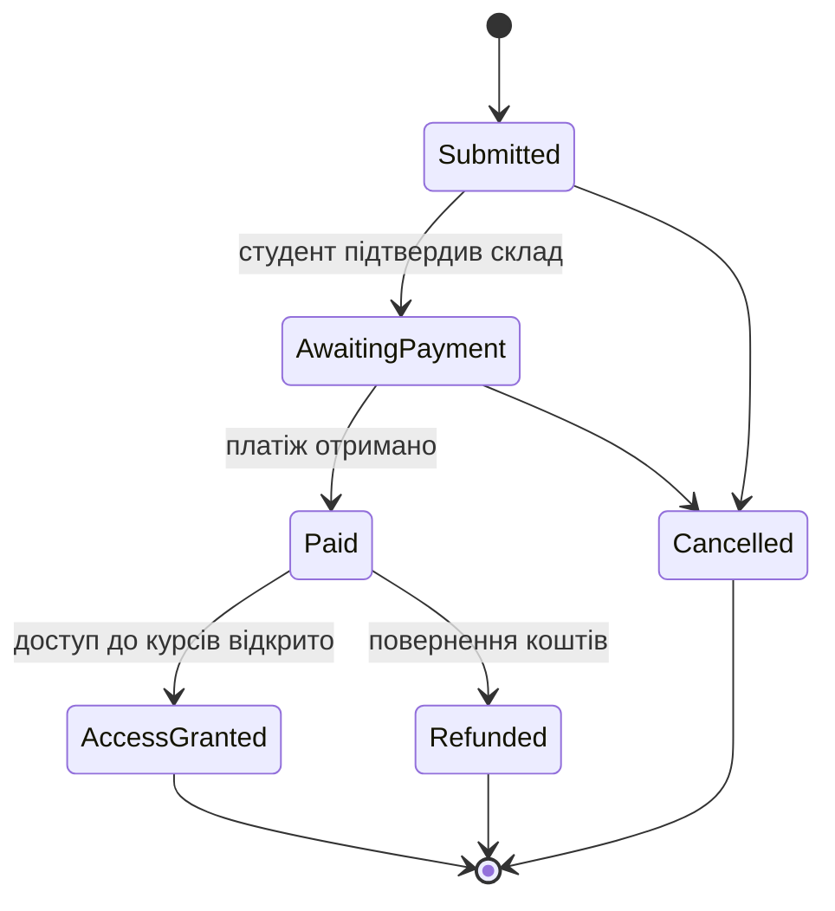

# Предметна область і обмежені контексти

## Предметна область

**Платформа онлайн-курсів.** Викладачі публікують платні курси з уроками, студенти знаходять їх у каталозі, оформлюють замовлення та оплачують його, після чого отримують доступ до навчання. Студенти залишають відгуки й оцінки та ставлять питання в обговореннях курсу, а викладачі на них відповідають.

## Три контексти

Систему поділено на три незалежні контексти. Кожен має власну базу даних і власну модель; спільних таблиць і міжсервісних JOIN-ів немає.

| Контекст | База даних | Технологія | Чому саме вона |
|---|---|---|---|
| **Enrollments** — замовлення та оплата | `EnrollmentsDb` (SQL Server) | ADO.NET + Dapper, збережувані процедури | Замовлення — транзакційний процес зі строгим життєвим циклом статусів; потрібні транзакції, блокування й перевірка цілісності на рівні бази |
| **Courses** — каталог курсів | `CoursesDb` (SQL Server) | EF Core, Code First | Багато сутностей зі зв'язками всіх типів і довідниковими даними; зручно описувати через Fluent API та змінювати міграціями |
| **Feedback** — відгуки й обговорення | `feedback_db` (MongoDB) | документна модель | Відгуки та повідомлення мають змінну структуру (фото, відео, фрагменти коду, вкладені відповіді) і читаються цілими агрегатами |

## Кому належить кожна сутність

Кожна сутність має рівно одного власника. Інші контексти знають про неї лише за ідентифікатором і, за потреби, зберігають копію окремих полів (див. [таблицю політики дублювання](../README.md#політика-дублювання-даних)).

| Контекст | Власні сутності |
|---|---|
| Enrollments | `Student`, `Order`, `OrderDetails`, `OrderItem`, `OrderStatusHistory` |
| Courses | `Instructor`, `Course`, `CourseDetail`, `Category`, `CourseCategory`, `Lesson` |
| Feedback | `reviews`, `discussions`, `messages`, `course_ratings` |

Таблиця `Courses` у `EnrollmentsDb` — не власна сутність контексту Enrollments, а локальна копія довідника з контексту Courses: сервіс Enrollments її лише читає, а змінює тільки обробник подій від власника.

## Агрегати та життєвий цикл

### Enrollments

- **Агрегат «Замовлення»**: корінь `Order` + `OrderDetails` (1:1) + `OrderItems` + `OrderStatusHistory`. Реквізити, позиції та журнал не існують без замовлення, змінюються лише через нього і фізично видаляються каскадом разом із ним.
- **Агрегат «Студент»**: `Student`. Замовлення посилається на студента за `StudentId`, але до агрегату студента не входить.

Життєвий цикл замовлення:

Скасувати замовлення можна лише до оплати, відкрити доступ — лише після неї. Перехід перевіряє процедура `usp_ChangeOrderStatus`: недопустимий перехід завершується керованою помилкою `50003`, дані не змінюються.

### Courses

- **Агрегат «Курс»**: корінь `Course` + `CourseDetail` (1:1) + `Lessons` + `CourseCategories`. Курс створюється чернеткою (`IsPublished = 0`), після публікації стає видимим у каталозі й доступним для купівлі.
- **Агрегат «Викладач»**: `Instructor`.
- **Довідник** `Category` — змінюється рідко, наповнюється початковими даними.

### Feedback

- **Агрегат «Відгук»** (`reviews`): відгук разом з автором і коментарями — один документ.
- **Агрегат «Обговорення»** (`discussions`): тема зі знімком останнього повідомлення; самі повідомлення (`messages`) винесено в окрему колекцію, бо їх кількість необмежена.
- **Проєкція «Рейтинг курсу»** (`course_ratings`): перераховується при кожному новому відгуку.

## Посилання між контекстами

Між базами немає жодного `FOREIGN KEY`. Посилання на чужу сутність — звичайний стовпець або поле з її ідентифікатором.

| Де | Поле | На що посилається | Обмеження в СУБД |
|---|---|---|---|
| `EnrollmentsDb.Courses` | `Id` | `CoursesDb.Courses.Id` | немає (той самий Id без `IDENTITY`) |
| `feedback_db.reviews` | `courseId` | `CoursesDb.Courses.Id` | немає |
| `feedback_db.reviews` | `author.studentId` | `EnrollmentsDb.Students.Id` | немає |
| `feedback_db.discussions`, `messages` | `author.userId` | `EnrollmentsDb.Students.Id` або `CoursesDb.Instructors.Id` (за `author.role`) | немає |
| `feedback_db.course_ratings` | `_id` | `CoursesDb.Courses.Id` | немає |

`OrderItems.CourseId` має звичайний FK, але на локальну таблицю `EnrollmentsDb.Courses` — тобто всередині однієї бази.

## Обґрунтування проєктних рішень

### Первинні ключі

У SQL-базах — `BIGINT IDENTITY` (для малого довідника `Categories` — `INT IDENTITY`). Рядки кожної таблиці створює лише один сервіс у власній базі, тож ідентифікатор генерується з одного джерела: вставка послідовна, кластерний індекс не фрагментується, ключ удвічі менший за GUID і дешевший у зовнішніх ключах та індексах. GUID був би виправданий, якби ідентифікатори створювались у кількох місцях незалежно (на клієнті, у різних сервісах, офлайн).

Два свідомі винятки:

- `EnrollmentsDb.Courses.Id` — без `IDENTITY`, бо значення приходить від власника (`CoursesDb`);
- `OrderItems` і `CourseCategories` — складений ключ із двох FK, що водночас забороняє дублікати пари.

У MongoDB — `ObjectId`, крім `course_ratings`, де `_id` дорівнює Id курсу: документ завжди шукають саме за курсом.

### Каскадне видалення

| Зв'язок | Правило | Чому |
|---|---|---|
| `Orders` → `OrderDetails`, `OrderItems`, `OrderStatusHistory` | `ON DELETE CASCADE` | частини агрегату не існують без кореня |
| `Students` → `Orders` | без каскаду | студента з історією замовлень видаляти не можна |
| `Courses` (копія) → `OrderItems` | без каскаду | курс, який уже купували, не можна прибрати з історії |
| `Courses` → `CourseDetails`, `Lessons`, `CourseCategories` | `ON DELETE CASCADE` | частини агрегату «Курс» |
| `Instructors` → `Courses` | без каскаду | викладача з курсами видаляти не можна |
| `Categories` → `CourseCategories` | без каскаду | категорію з курсами видаляти не можна |

Звичайний шлях видалення — м'який (`IsDeleted = 1`); каскад описує лише фізичне видалення.

### Аудит, м'яке видалення, конкурентність

- `CreatedAt`, `CreatedBy`, `UpdatedAt`, `UpdatedBy` — на всіх змінюваних таблицях.
- `IsDeleted` — на коренях агрегатів (`Students`, `Orders`, `Courses`, `Instructors`): дочірні рядки «видаляються» разом із коренем, окремої позначки їм не потрібно.
- `RowVersion ROWVERSION` — там, де один рядок можуть одночасно змінювати два джерела:
  - `Orders` — статус змінює платіжний обробник, і водночас студент може скасувати замовлення;
  - `Students`, `Instructors` — профіль редагують власник і адміністратор;
  - `Courses` (обидві бази) — курс редагують викладач і модератор; у копії довідника паралельно обробляються дві події.
- `OrderStatusHistory` лише дописується, тому `UpdatedAt`, `IsDeleted` і `RowVersion` там немає.
- У MongoDB ту саму роль відіграють поля `createdAt`, `updatedAt`, `isDeleted` і числовий токен `version` у `reviews`.

Оптимістична конкурентність обрана замість тривалих блокувань: конфлікти рідкісні, а тримати блокування між запитом користувача і його відповіддю неможливо. Усередині однієї короткої транзакції процедури додатково беруть `UPDLOCK` на рядок замовлення.

### Нормалізація

SQL-схеми нормалізовано до 3НФ. Свідомі відступи — лише дубльовані поля з таблиці політики (`OrderItems.CourseTitle`, `UnitPrice`, `Orders.TotalAmount` як збережена сума позицій, `Courses.AverageRating`). Для читання без JOIN-ів у прикладному коді є представлення `vw_OrderSummary`.
