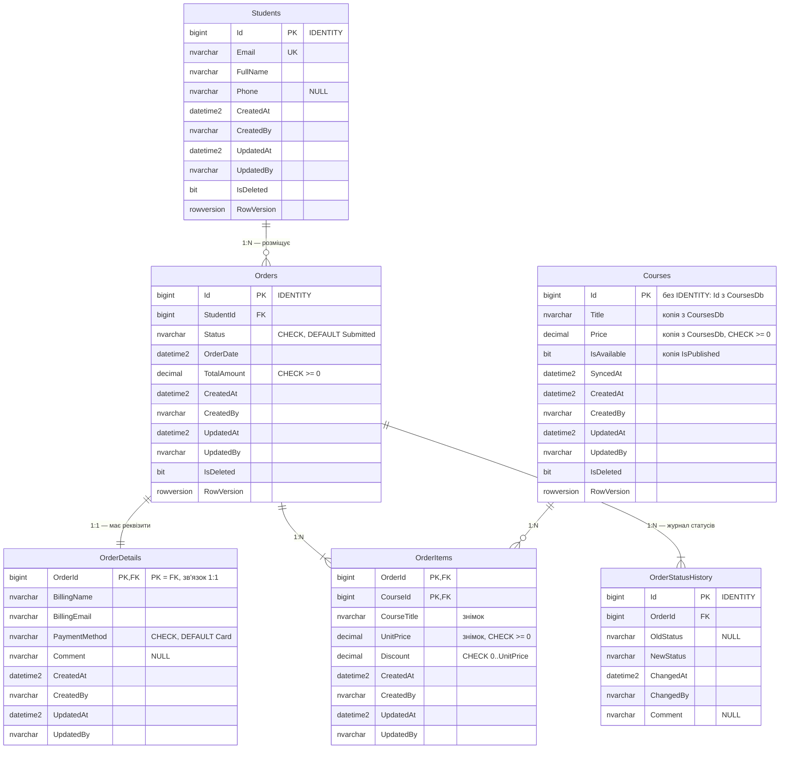

# ERD — Проєкт №1, `EnrollmentsDb`

Скрипти: [schema.sql](../db/p1/schema.sql) · [procedures.sql](../db/p1/procedures.sql) · [seed.sql](../db/p1/seed.sql)

Зображення діаграми: [erd-p1.png](erd-p1.png). Нижче — її вихідний текст.

## Зв'язки

| Тип | Таблиці | Як реалізовано |
|---|---|---|
| 1:1 | `Orders` ↔ `OrderDetails` | `OrderDetails.OrderId` — водночас первинний і зовнішній ключ |
| 1:N | `Students` → `Orders` | `Orders.StudentId` — FK на боці «багатьох» |
| 1:N | `Orders` → `OrderStatusHistory` | `OrderStatusHistory.OrderId` — FK на боці «багатьох» |
| M:N | `Orders` ↔ `Courses` | проміжна таблиця `OrderItems` з двома FK, складеним PK і власними полями |

## Обмеження

| Вид | Де |
|---|---|
| `PRIMARY KEY` | усі таблиці; складений у `OrderItems (OrderId, CourseId)` |
| `FOREIGN KEY` | `Orders.StudentId`, `OrderDetails.OrderId`, `OrderItems.OrderId`, `OrderItems.CourseId`, `OrderStatusHistory.OrderId` — усі в межах цієї бази |
| `UNIQUE` | `Students.Email` |
| `CHECK` | `Orders.Status` (6 статусів), `Orders.TotalAmount >= 0`, `Courses.Price >= 0`, `OrderItems.UnitPrice >= 0`, `OrderItems.Discount` у межах `0..UnitPrice`, `OrderDetails.PaymentMethod`, формат `Students.Email` |
| `DEFAULT` | `Orders.Status = 'Submitted'`, `OrderDate`, `TotalAmount = 0`, `OrderItems.Discount = 0`, `PaymentMethod = 'Card'`, `CreatedAt`, `IsDeleted = 0` |

## Індекси та запити, під які їх створено

| Індекс | Стовпці | Запит |
|---|---|---|
| `IX_Orders_StudentId_Status` | `(StudentId, Status)` INCLUDE `(OrderDate, TotalAmount)`, фільтр `IsDeleted = 0` | «мої замовлення» з фільтром за статусом — `usp_GetStudentOrders` |
| `IX_Orders_AwaitingPayment` | `(OrderDate)` INCLUDE `(StudentId, TotalAmount)`, фільтр `Status = 'AwaitingPayment' AND IsDeleted = 0` | фонове завдання: неоплачені замовлення, старші за N годин |
| `IX_OrderItems_CourseId` | `(CourseId)` INCLUDE `(UnitPrice, Discount)` | у яких замовленнях є курс і скільки на ньому зароблено |
| `IX_OrderStatusHistory_OrderId_ChangedAt` | `(OrderId, ChangedAt)` INCLUDE `(OldStatus, NewStatus, ChangedBy)` | історія статусів замовлення в хронологічному порядку — `usp_GetOrderById` |
| `UQ_Students_Email` | `(Email)` унікальний | пошук студента за Email під час оформлення замовлення |
| `PK_OrderItems` | `(OrderId, CourseId)` кластерний | позиції одного замовлення |

На `Courses` додаткових індексів свідомо немає: таблицю читають лише за первинним ключем.

## Збережувані процедури

| Процедура | Операція | Транзакція | Що робить |
|---|---|---|---|
| `usp_CreateOrder` | Create | так | створює `Orders`, `OrderDetails` і перший запис журналу |
| `usp_AddOrderItem` | Update | так | додає курс, фіксує знімок назви й ціни, перераховує суму |
| `usp_GetOrderById` | Read | ні | замовлення, позиції та історія — три набори результатів |
| `usp_GetStudentOrders` | Read | ні | замовлення студента з фільтром і пагінацією |
| `usp_ChangeOrderStatus` | Update | так | змінює статус лише за допустимим переходом, пише в журнал |
| `usp_DeleteOrder` | Delete | так | м'яке видалення чернетки або скасованого замовлення |

Допустимі переходи статусів і керовані помилки описано в [contexts.md](contexts.md#enrollments) та в шапці [procedures.sql](../db/p1/procedures.sql).
