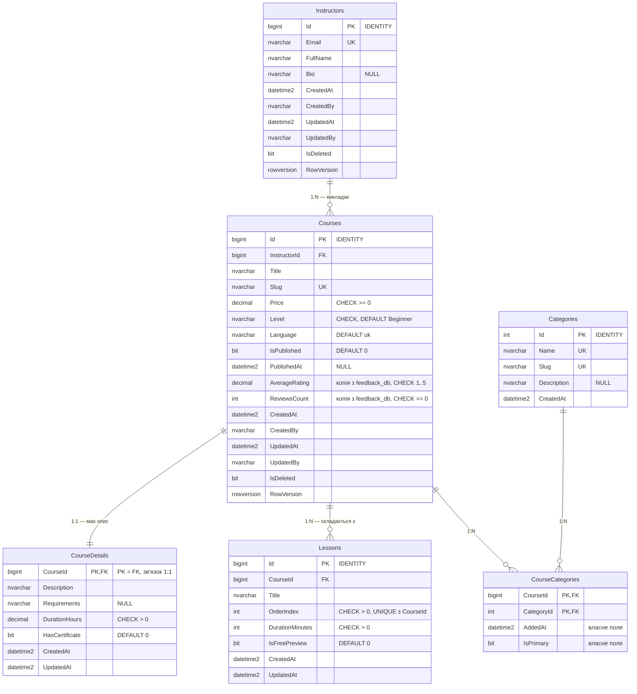

# ERD — Проєкт №2, `CoursesDb`

Скрипти: [schema.sql](../db/p2/schema.sql) · [seed.sql](../db/p2/seed.sql)

Зображення діаграми: [erd-p2.png](erd-p2.png). Нижче — її вихідний текст.

На цьому етапі спроєктовано схему; її реалізація засобами EF Core (Code First, Fluent API, міграції) — у Лаб. 03.

## Сутності (6)

`Instructor`, `Course`, `CourseDetail`, `Category`, `CourseCategory`, `Lesson`.

## Зв'язки

| Тип | Таблиці | Як реалізовано |
|---|---|---|
| 1:1 | `Courses` ↔ `CourseDetails` | `CourseDetails.CourseId` — водночас первинний і зовнішній ключ |
| 1:N | `Instructors` → `Courses` | `Courses.InstructorId` — FK на боці «багатьох» |
| 1:N | `Courses` → `Lessons` | `Lessons.CourseId` — FK на боці «багатьох» |
| M:N | `Courses` ↔ `Categories` | проміжна сутність `CourseCategories` з двома FK і **власними полями** `AddedAt` (дата додавання курсу в категорію) та `IsPrimary` (основна категорія) |

## Обмеження

| Вид | Де |
|---|---|
| `PRIMARY KEY` | усі таблиці; складений у `CourseCategories (CourseId, CategoryId)` |
| `FOREIGN KEY` | `Courses.InstructorId`, `CourseDetails.CourseId`, `CourseCategories.CourseId`, `CourseCategories.CategoryId`, `Lessons.CourseId` — усі в межах цієї бази |
| `UNIQUE` | `Instructors.Email`, `Courses.Slug`, `Categories.Name`, `Categories.Slug`, `Lessons (CourseId, OrderIndex)`, одна основна категорія на курс |
| `CHECK` | `Courses.Price >= 0`, `Courses.Level`, `AverageRating` у межах 1..5, `ReviewsCount >= 0`, опублікований курс має `PublishedAt`, `DurationHours > 0`, `OrderIndex > 0`, `DurationMinutes > 0`, формат `Instructors.Email` |
| `DEFAULT` | `Level = 'Beginner'`, `Language = 'uk'`, `IsPublished = 0`, `ReviewsCount = 0`, `AddedAt`, `IsPrimary = 0`, `CreatedAt`, `IsDeleted = 0` |

## Індекси та запити, під які їх створено

| Індекс | Стовпці | Запит |
|---|---|---|
| `IX_Courses_Level_Price` | `(Level, Price)` INCLUDE `(Title, Slug, AverageRating, ReviewsCount)`, фільтр `IsPublished = 1 AND IsDeleted = 0` | каталог: опубліковані курси рівня, відсортовані за ціною |
| `IX_Courses_InstructorId` | `(InstructorId)` INCLUDE `(Title, IsPublished)`, фільтр `IsDeleted = 0` | кабінет викладача: усі мої курси |
| `IX_Courses_Title` | `(Title)` | пошук за початком назви |
| `IX_CourseCategories_CategoryId` | `(CategoryId, AddedAt DESC)` | курси категорії, спершу нещодавно додані |
| `UX_CourseCategories_Primary` | `(CourseId)` унікальний, фільтр `IsPrimary = 1` | основна категорія курсу; гарантує, що вона одна |
| `UQ_Courses_Slug` | `(Slug)` унікальний | сторінка курсу за адресою `/courses/{slug}` |
| `UQ_Lessons_CourseId_OrderIndex` | `(CourseId, OrderIndex)` унікальний | уроки курсу в порядку проходження |

## Довідникові дані

[seed.sql](../db/p2/seed.sql) наповнює довідник `Categories` (5 категорій), а також додає 3 викладачів, 6 курсів (5 опублікованих і 1 чернетку), описи, зв'язки з категоріями та 12 уроків.

## Готовність до змін структури

Назви таблиць, ключів та обмежень відповідають угодам EF Core, тому початкова міграція `InitialCreate` у Лаб. 03 відтворить цю схему без перейменувань. Подальші зміни виконуються міграціями (`dotnet ef migrations add <Name>`), які зберігаються разом із кодом сервісу Courses.
