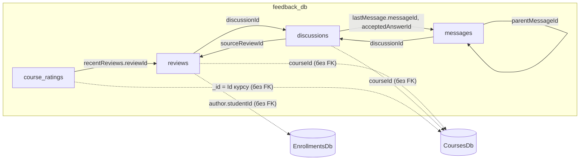

# Документна модель — Проєкт №3, `feedback_db`

Скрипти: [collections.js](../db/p3/collections.js) · [seed.js](../db/p3/seed.js) · [queries.js](../db/p3/queries.js)

## Колекції

| Колекція | Що зберігає | Прийом моделювання |
|---|---|---|
| `reviews` | відгук студента про курс | **гібрид**: вбудовані автор і коментарі + посилання `discussionId` |
| `discussions` | тема обговорення курсу | **гібрид**: вбудований знімок `lastMessage` + посилання на `messages` |
| `messages` | повідомлення в темі | **referencing**: `discussionId`, `parentMessageId` |
| `course_ratings` | зведений рейтинг курсу | **embedding**: розподіл оцінок і останні відгуки всередині документа |



Суцільна лінія — посилання всередині бази за `ObjectId`; пунктир — логічне посилання на іншу базу за числовим Id.

## Коли вбудовування, а коли посилання

| Дані | Рішення | Чому |
|---|---|---|
| автор відгуку (`author`) | вбудовано | завжди читається разом із відгуком, складається з двох полів |
| коментарі до відгуку (`comments`) | вбудовано, не більше 50 | їх небагато, і вони потрібні щоразу, коли показують відгук |
| довга розмова під відгуком | посилання `discussionId` | якщо коментарів стає багато, розмова продовжується в окремій темі |
| повідомлення теми (`messages`) | окрема колекція з посиланням | кількість необмежена; вбудований масив упирався б у ліміт документа 16 МБ і перезаписувався б цілком при кожній відповіді |
| останнє повідомлення теми (`lastMessage`) | вбудований знімок + `messageId` | список тем показується одним запитом без звернення до `messages` |
| розподіл оцінок, останні відгуки курсу | вбудовано в `course_ratings` | сторінка курсу отримує все одним читанням за `_id` |

## Приклади документів

### `reviews` — гібридний документ

Поєднує вбудований об'єкт, вбудований масив, посилання на іншу колекцію та денормалізовані поля.

```json
{
  "_id": ObjectId("670000000000000000000101"),
  "courseId": 1,
  "courseTitle": "C# для початківців",
  "author": { "studentId": 1, "displayName": "Олена Коваль" },
  "rating": 5,
  "text": "Найзрозуміліший курс для старту: багато практики, кожна тема закріплюється завданням.",
  "isVerifiedPurchase": true,
  "photos": ["reviews/101/certificate.jpg", "reviews/101/final-project.png"],
  "comments": [
    {
      "author": { "userId": 1, "role": "instructor", "displayName": "Андрій Мельник" },
      "text": "Дякую за відгук! Успіхів із наступним курсом.",
      "createdAt": ISODate("2026-09-21T08:30:00Z")
    }
  ],
  "discussionId": ObjectId("670000000000000000000201"),
  "createdAt": ISODate("2026-09-20T19:00:00Z"),
  "updatedAt": ISODate("2026-09-22T17:05:00Z"),
  "isDeleted": false,
  "version": 3
}
```

| Поле | Прийом |
|---|---|
| `courseId` | посилання на курс у `CoursesDb`, без FK |
| `courseTitle` | денормалізація для читання — поле з таблиці політики дублювання |
| `author` | вбудований об'єкт; `displayName` — дубльоване поле |
| `comments` | вбудований масив піддокументів |
| `discussionId` | посилання на колекцію `discussions` |
| `photos` | масив, який є лише в частини документів |
| `version` | токен оптимістичної конкурентності |

### `reviews` — гнучка схема

У тій самій колекції лежать документи з іншими наборами полів. Обов'язкове лише ядро: `courseId`, `courseTitle`, `author`, `rating`, `isVerifiedPurchase`, `createdAt`.

Відеовідгук із перевагами й недоліками — без `text`, `photos`, `comments`:

```json
{
  "_id": ObjectId("670000000000000000000103"),
  "courseId": 2,
  "courseTitle": "ASP.NET Core Web API",
  "author": { "studentId": 1, "displayName": "Олена Коваль" },
  "rating": 5,
  "isVerifiedPurchase": true,
  "videoUrl": "https://cdn.example.com/reviews/103/review.mp4",
  "pros": ["Реальний проєкт від початку до кінця", "Розбір типових помилок"],
  "cons": ["Мало про тестування"],
  "createdAt": ISODate("2026-10-05T16:45:00Z"),
  "isDeleted": false,
  "version": 1
}
```

Лише оцінка, без тексту:

```json
{
  "_id": ObjectId("670000000000000000000104"),
  "courseId": 3,
  "courseTitle": "Entity Framework Core на практиці",
  "author": { "studentId": 4, "displayName": "Дмитро Гончар" },
  "rating": 4,
  "isVerifiedPurchase": false,
  "createdAt": ISODate("2026-10-06T09:10:00Z"),
  "isDeleted": false,
  "version": 1
}
```

### `discussions` — знімок останнього повідомлення і посилання

```json
{
  "_id": ObjectId("670000000000000000000201"),
  "courseId": 1,
  "courseTitle": "C# для початківців",
  "title": "Чи достатньо цього курсу, щоб перейти до ASP.NET Core?",
  "type": "question",
  "author": { "userId": 3, "role": "student", "displayName": "Софія Лисенко" },
  "status": "resolved",
  "tags": ["csharp", "навчальний-план"],
  "messagesCount": 3,
  "lastMessage": {
    "messageId": ObjectId("670000000000000000000303"),
    "authorName": "Олена Коваль",
    "textPreview": "Я так і зробила: після модуля про класи взяла курс про Web API.",
    "createdAt": ISODate("2026-09-24T09:15:00Z")
  },
  "acceptedAnswerId": ObjectId("670000000000000000000302"),
  "sourceReviewId": ObjectId("670000000000000000000101"),
  "createdAt": ISODate("2026-09-23T10:00:00Z"),
  "updatedAt": ISODate("2026-09-24T09:15:00Z")
}
```

Оголошення викладача в тій самій колекції має інший набір полів: є `isPinned`, немає `tags`, `lastMessage`, `acceptedAnswerId`.

### `messages` — посилання на тему та батьківське повідомлення

```json
{
  "_id": ObjectId("670000000000000000000305"),
  "discussionId": ObjectId("670000000000000000000202"),
  "parentMessageId": ObjectId("670000000000000000000304"),
  "author": { "userId": 2, "role": "instructor", "displayName": "Ірина Шевченко" },
  "text": "Рядок підключення береться з проєкту запуску — вкажіть його параметром.",
  "isInstructorAnswer": true,
  "codeSnippet": { "language": "bash", "code": "dotnet ef database update --startup-project ../Courses.Api" },
  "createdAt": ISODate("2026-10-04T13:40:00Z"),
  "editedAt": ISODate("2026-10-04T13:45:00Z")
}
```

Поля `parentMessageId`, `isInstructorAnswer`, `codeSnippet`, `attachments`, `reactions`, `editedAt` є лише в частини повідомлень.

### `course_ratings` — вкладені об'єкт і масив

```json
{
  "_id": 1,
  "courseTitle": "C# для початківців",
  "reviewsCount": 2,
  "averageRating": 4.5,
  "distribution": { "1": 0, "2": 0, "3": 0, "4": 1, "5": 1 },
  "recentReviews": [
    {
      "reviewId": ObjectId("670000000000000000000102"),
      "authorName": "Софія Лисенко",
      "rating": 4,
      "textPreview": "Добрий курс, але хотілося б більше про асинхронність.",
      "createdAt": ISODate("2026-10-02T11:20:00Z")
    }
  ],
  "updatedAt": ISODate("2026-10-02T11:20:00Z")
}
```

## Контроль схеми

Кожна колекція створюється з валідатором `$jsonSchema`. Він перевіряє обов'язкове ядро документа й типи (`rating` — ціле від 1 до 5, `status` — одне з трьох значень), але не забороняє додаткові поля, тому схема залишається гнучкою.

## Індекси та запити, під які їх створено

| Колекція | Індекс | Запит |
|---|---|---|
| `reviews` | `{ courseId: 1, createdAt: -1 }` | відгуки курсу, найновіші перші |
| `reviews` | `{ courseId: 1, "author.studentId": 1 }` унікальний | чи залишав студент відгук; один відгук студента на курс |
| `reviews` | `{ "author.studentId": 1 }` | мої відгуки; оновлення `displayName` за подією |
| `reviews` | `{ discussionId: 1 }` частковий | відгук, з якого виросла тема |
| `discussions` | `{ courseId: 1, status: 1, updatedAt: -1 }` | теми курсу зі статусом, спершу з останньою активністю |
| `discussions` | `{ tags: 1 }` multikey | теми за тегом |
| `discussions` | `{ title: "text" }` | повнотекстовий пошук по заголовках |
| `messages` | `{ discussionId: 1, createdAt: 1 }` | повідомлення теми в хронологічному порядку |
| `messages` | `{ parentMessageId: 1 }` частковий | відповіді на повідомлення |
| `messages` | `{ "author.role": 1, "author.userId": 1 }` | оновлення `displayName` за подією |

## Приклади запитів і агрегацій

Повний набір — у [queries.js](../db/p3/queries.js). Основні:

```javascript
// відгуки курсу з пагінацією
db.reviews.find({ courseId: 1, isDeleted: false }).sort({ createdAt: -1 }).skip(0).limit(10);

// середня оцінка по курсах
db.reviews.aggregate([
  { $match: { isDeleted: false } },
  { $group: { _id: "$courseId", reviewsCount: { $sum: 1 }, averageRating: { $avg: "$rating" } } },
  { $sort: { averageRating: -1 } }
]);

// тема разом із повідомленнями ($lookup по посиланню)
db.discussions.aggregate([
  { $match: { courseId: 3, status: "open" } },
  { $lookup: { from: "messages", localField: "_id", foreignField: "discussionId", as: "messages" } }
]);

// хто найчастіше коментує відгуки ($unwind вбудованого масиву)
db.reviews.aggregate([
  { $unwind: "$comments" },
  { $group: { _id: "$comments.author.displayName", comments: { $sum: 1 } } },
  { $sort: { comments: -1 } }
]);
```
